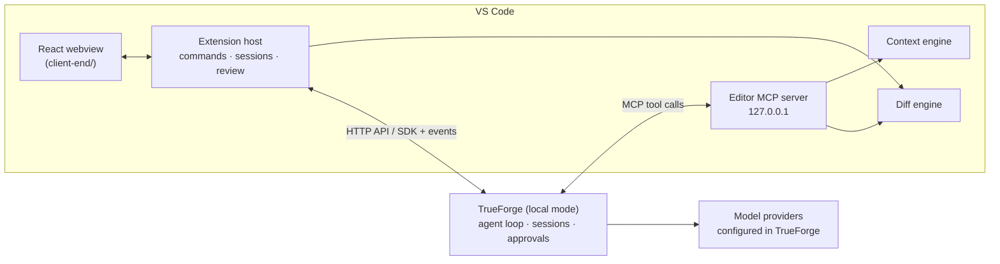

# FORGE

**Think. Understand. Engineer. Verify.**

FORGE is an AI software-engineering agent for Visual Studio Code. You describe a task in plain language; FORGE finds the relevant code in your repository, plans the change, edits several files, runs your tests, and shows every modification as a reviewable diff before anything touches disk. The agent loop runs on [TrueForge](https://github.com/truefoundry/trueforge) (TrueFoundry's open-source agent harness); FORGE is the editor-native client and tool provider.

> ### Project status (2026-11-20)
> The backend and VS Code extension are **built and verified with a scripted model**: 79 unit/integration tests, 11 live tests against **real TrueForge** and the **real Flask 3.1.3** repo, and 86 checks inside a **real VS Code** (Task A inline edit, automatic fallback, unreachable-endpoint error, resume across a real restart; `git status` clean afterwards). **No real LLM has been run against the three tasks yet**, the React UI in `client-end/` has **not** been built (that folder is deliberately untouched), and the repo has **no `LICENSE`** yet. Full evidence and gaps: [context/progress_tracker.md](context/progress_tracker.md).
>
> **Frontend location:** `/Users/aryansingh/Documents/QuantForge_IITB/client-end/`.
>
> Built for the **TrueFoundry Forge-a-thon, Techfest IIT Bombay 2026–27**.

**Documents (in `context/`):** [architecture](context/architecture.md) · [plan](context/plan.md) · [UI registry](context/Ui-regitry.md) · [agent rules](context/Agents.md) · [progress tracker](context/progress_tracker.md)

## Contents
1. [Introduction](#1-project-introduction) · 2. [Why FORGE](#2-why-forge) · 3. [Features](#3-key-features) · 4. [Architecture](#4-architecture) · 5. [Tech stack](#5-technology-stack) · 6. [Prerequisites](#6-prerequisites) · 7. [Installation](#7-installation) · 8. [TrueForge setup](#8-trueforge-setup) · 9. [Development](#9-development-setup) · 10. [Structure](#10-project-structure) · 11. [Configuration](#11-configuration) · 12. [Security](#12-security) · 13. [Competition demo](#13-competition-demonstration) · 14. [Roadmap](#14-roadmap) · 15. [Limitations](#15-limitations) · 16. [Contributing](#16-contributing) · 17. [Licence](#17-licence-and-attribution) · 18. [Acknowledgements](#18-acknowledgements)

---

## 1. Project Introduction

- **Name:** FORGE
- **Tagline:** Think. Understand. Engineer. Verify.
- **What it is:** a VS Code extension that behaves like an engineering collaborator, not a chatbot. A developer states an outcome ("add a `config` CLI command, tested and documented"); the agent discovers the files, edits them, verifies, and presents hunks to accept or reject.
- **Value proposition:** (1) repository-aware context with *visible reasoning* about what was selected and why; (2) autonomous multi-file changes where you never name files; (3) the developer owns every write — no silent changes, per-hunk review, undo; (4) model independence and resilience, because models are configured in TrueForge and failures degrade gracefully.

## 2. Why FORGE?

| Common problem with AI coding assistants | How FORGE is designed to address it |
|---|---|
| **Incomplete repository understanding** — the model sees only what was pasted or the open file | Symbol- and dependency-aware retrieval (ripgrep + Tree-sitter + VS Code language services) behind agent-callable tools |
| **Poor context selection** — whole files are stuffed in until the window fills | Ranked, token-budgeted context with tiers (full → symbols → skeleton → path) and exclusion reasons |
| **Unsafe modifications** — edits land on disk before you've looked | Edits are *proposals*; only an approved review applies them, per hunk, with undo |
| **Limited multi-file reasoning** | A TrueForge-driven tool loop (search → read → plan → edit → test) with subagents for discovery |
| **Opaque execution** | Execution timeline, context inspector and the TrueForge session/turn/tool-call log |
| **Provider lock-in and fragility** | Models live in TrueForge; FORGE retries with backoff and can fall back to a second configured model |

## 3. Key Features

Legend: ✅ implemented and verified (with a scripted model — see status box) · 🟡 partial · 📐 planned.

| Feature | Status | Notes |
|---|---|---|
| Inline edit (`Cmd/Ctrl+Alt+K`) | ✅ | Selection + instruction → proposal → native diff, per-hunk CodeLens Accept/Reject, apply, undo. Verified in real VS Code |
| Autonomous agent mode | ✅ | TrueForge loop + 11 MCP tools; Task B edits 3 files none named in the prompt; commands verified in a shadow copy |
| Context engine | ✅ | ripgrep + Tree-sitter (Python, TS/JS) + import graph + test affinity; IDF-weighted ranking; tiered token budget (hard cap); reasons and exclusions |
| Context inspector + `@` picker | ✅ | Sidebar tab shows items, tiers, tokens, reasons, exclusions, budget; `@` dropdown suggests files and symbols |
| Diff review & safety | ✅ | Hunks, per-hunk accept/reject, apply via `WorkspaceEdit`, undo journal, stale/conflict detection; nothing is written before approval |
| Review Gate | ✅ | `submit_changes` is approval-gated by TrueForge; its approval *is* the review |
| Streaming | ✅ | Token deltas (coalesced per frame) and tool events stream to the sidebar |
| Cancellation | ✅ | Stop aborts TrueForge's turn *and* FORGE's running tools; process groups reaped; tree stays clean |
| Model resilience | ✅ | Real TrueForge error payloads classified; backoff with jitter; stall detection; automatic fallback to a second configured model |
| Execution timeline / plan | 🟡 | Basic tabs in a vanilla sidebar |
| React UI per the UI registry | 📐 | Not built; `client-end/` untouched |
| Resume after window reload | ✅ | Persists the turn, review queue and conversation; offers *Resume*; verified across a real VS Code restart |
| Crash recovery of applied changes | ✅ | Intent/commit journal; reconciled at startup |
| Persistent symbol index (SQLite FTS5) | ✅ | Optional, incremental, falls back automatically |
| Packaged `.vsix` | ✅ | `npm run package` (per-platform; includes ripgrep) |
| Welcome/Settings/Model screens | 📐 | Part of the unbuilt React UI |

## 4. Architecture



TrueForge owns the loop and talks to models; FORGE hosts the editor tools and owns review and writes. Details, sequence diagrams and state machines: [architecture.md](context/architecture.md).

## 5. Technology Stack

Versions are pinned in the package manifests.

| Technology | Role | Status in repo |
|---|---|---|
| TypeScript (strict) | Primary language | Present (TypeScript 5.9.3, strict, all packages) |
| VS Code Extension API | Editor integration | Present |
| [TrueForge](https://github.com/truefoundry/trueforge) + `@truefoundry/trueforge-sdk` | Agent loop, sessions, turns, approvals, model access | Present |
| MCP (`@modelcontextprotocol/sdk`) | Editor tool interface for the agent | Present |
| React 19 | Webview UI | Present in `client-end/` (`react 19.3.0`) |
| Next.js 16 | Component gallery / mock-host harness | Present in `client-end/` (`next 16.4.6`, unmodified starter) |
| Tailwind CSS 4 | Styling via design tokens | Present in `client-end/` (`tailwindcss 4.3.3`) |
| shadcn/ui, Lucide | Primitives and icons | Planned (React UI not built) |
| Tree-sitter (`@vscode/tree-sitter-wasm`, WASM) | Symbol extraction, skeleton compression | Present |
| ripgrep (`@vscode/ripgrep`) | Workspace search | Present |
| SQLite + FTS5 | Optional persistent symbol index | Planned (optional) |
| jsdiff (`diff`) | Diff and hunk generation | Present |
| esbuild | Extension and webview bundling | Present |
| Vitest · `@vscode/test-electron` · Playwright | Unit · real-VS-Code integration · UI tests | Present · Present · Planned |
| npm workspaces | Monorepo | Present |

## 6. Prerequisites

| Requirement | Version / note |
|---|---|
| Node.js | **≥ 22.14** — verified requirement of TrueForge (per its README/quickstart). The audit machine runs Node v26.13.1 with npm 11.20.0 (works for the commands that were run). The range required by Next.js 16.4.6 was **not verified**. |
| npm | Ships with Node; lockfile is `client-end/package-lock.json` (npm) |
| VS Code | Required for the extension; the minimum version will be fixed in the extension's `engines.vscode` (**not yet determined**) |
| Git | Needed for the Flask fixture and for the review/shadow features |
| TrueForge | Run via `npx @truefoundry/trueforge@latest` (no install needed) |
| A model | Any provider/endpoint configured **inside TrueForge** (catalog provider or OpenAI-compatible endpoint, including a local model) |
| Python 3 + `pytest` | Only to run the competition demo tasks against Flask |

## 7. Installation

> Replace `<repo-url>` with the public GitHub URL once published.

```bash
git clone <repo-url> QuantForge_IITB && cd QuantForge_IITB
npm ci                    # installs all workspaces (packages/*)
npm run typecheck         # strict TypeScript, 6 packages
npm test                  # 79 unit + MCP + eligibility-guard tests
node scripts/build.mjs    # bundles the extension to packages/extension/dist (+ wasm, ripgrep, agents)
```
The competition fixture (needs Python ≥ 3.9, git, network): `eval/setup-flask.sh` (clones Flask 3.1.3, asserts commit `22d92470`, creates a venv with an editable install and `pytest<9`).

## 8. TrueForge Setup

Facts below were verified against a real local TrueForge on 2026-11-20.

1. **Start TrueForge** (local mode, SQLite). It must be allowed to call FORGE's loopback tool server, which its SSRF guard blocks by default:
   ```bash
   OUTBOUND_URL_ALLOWED_HOSTS='["127.0.0.1"]' npx --yes @truefoundry/trueforge@latest
   ```
   Open http://localhost:8790 (or `--port N`). The VS Code command **FORGE: Start TrueForge (local mode)** does this for you. Keep it on localhost (TrueForge documents local mode as personal-use, no login).
2. **Configure models** in TrueForge → Settings → Models (catalog provider + key, or a `custom` OpenAI-compatible endpoint, e.g. a local model). Configure **two** to enable automatic fallback. Keys never touch FORGE or this repo.
3. **Tell FORGE which models to use** (VS Code settings, see `config/forge.example.json`): `forge.model.primary`, `forge.model.fallbacks`, `forge.trueforge.baseUrl` (default `http://localhost:8790`).
4. **Agent definitions** are in `agents/` (`forge-agent.json`, `forge-inline-edit.json` + instructions). The extension injects the model name and creates an **inline spec** session per task; TrueForge shows each session/turn/tool call under its **Sessions** page.
5. **Tool registration** is automatic: on activation FORGE starts its MCP server on `127.0.0.1:<random>` with a per-run bearer token and registers it in TrueForge via `POST /api/v1/settings/mcp-servers`. Without VS Code: `npm run forge:setup -- --workspace <dir> --tf http://localhost:8790`.

## 9. Development Setup

| Step | Command |
|---|---|
| Install | `npm ci` |
| Typecheck | `npm run typecheck` |
| Unit + MCP tests | `npm test` |
| Live tests (real TrueForge + Flask + scripted model; needs network once for `npx`) | `eval/setup-flask.sh && npm run test:live` |
| Real VS Code tests (isolated profile; uses `/Applications/Visual Studio Code.app`, override with `FORGE_VSCODE_EXE`) | `npm run test:vscode` |
| Everything | `eval/run-fixed-tasks.sh` |
| Build the extension | `node scripts/build.mjs` |
| Package a `.vsix` | `npm run package` → `packages/extension/forge-<platform>-<arch>.vsix`; install with `code --install-extension <file>` |
| Run it | Open this repo in VS Code → *Run and Debug* → launch an **Extension Development Host** with `extensionDevelopmentPath=packages/extension` (or `code --extensionDevelopmentPath=packages/extension <workspace>`) |
| Headless tool server | `npm run forge:serve -- --workspace <dir> [--auto-accept]` (`--auto-accept` is for the evaluation harness only) |

Contributors (human or AI) follow [context/Agents.md](context/Agents.md) and update [context/progress_tracker.md](context/progress_tracker.md). Before changing anything in `client-end/`, read `client-end/AGENTS.md`.

## 10. Project Structure

```
QuantForge_IITB/
├─ README.md                      this file
├─ context/                       architecture · plan · UI registry · agent rules · progress tracker · competition PDF
├─ packages/
│  ├─ protocol/                   zod schemas: webview messages, MCP tool inputs, shared types
│  ├─ diff-engine/                hunks, review queue, apply/undo journal (no vscode import)
│  ├─ context-engine/             ripgrep + Tree-sitter retrieval, ranking, token budget (no vscode import)
│  ├─ editor-mcp/                 MCP server, 11 tools, path safety, terminal policy, shadow workspace, headless runner
│  ├─ trueforge-client/           SDK wrapper, turn runner, error classifier, retry/fallback, scripted fake model (tests)
│  └─ extension/                  VS Code extension: controller, review UI, sidebar, WorkspaceEdit store
├─ agents/                        TrueForge agent definitions + instructions (loaded at runtime)
├─ config/                        forge.example.json (no secrets)
├─ eval/                          Flask 3.1.3 fixture scripts and runner
├─ scripts/                       build.mjs (esbuild bundle), setup-trueforge.mts
└─ client-end/                    frontend workspace (Next.js starter, untouched)
```
Dependency direction: `protocol` ← `diff-engine`, `context-engine` ← `editor-mcp` ← `extension`; only `extension` imports `vscode`.

## 11. Configuration

VS Code settings contributed by the extension (all verified present in `packages/extension/package.json`). Never put API keys here — models and keys are configured in TrueForge.

```jsonc
// config/forge.example.json — safe example, contains no credentials
{
  "forge.trueforge.baseUrl": "http://localhost:8790",
  "forge.model.primary": "<provider/model as named in TrueForge>",
  "forge.model.fallbacks": ["<second provider/model as named in TrueForge>"],
  "forge.context.budgetTokens": 24000,
  "forge.context.exclude": ["**/node_modules/**", "**/*.lock", "**/dist/**", "**/.env*"],
  "forge.stallTimeoutMs": 45000,
  "forge.review.autoOpenOnPause": true
}
```

If TrueForge hosted mode with login is ever used, the ID token is kept in VS Code SecretStorage, not in settings.

**Models used (competition requirement):** none yet — no model has been run. The write-up must list every model, where it ran, and approximate cost.

## 12. Security

- **Local-first:** TrueForge local mode, a loopback-only MCP server (bearer token, Origin check), no FORGE backend, no telemetry. Source code leaves the machine only through the model endpoint *you* configured in TrueForge (use a local OpenAI-compatible endpoint to keep it on-device).
- **Secrets:** FORGE stores none. `.env*`, keys and certificates are excluded from tools by default. Never commit keys; the repo ships an example config only.
- **Workspace boundaries:** every tool path is normalized, realpath-checked and confined to the workspace; symlink escapes and traversal are rejected; untrusted workspaces are read-only.
- **Tool approvals:** terminal commands require your approval *and* pass a default-deny allowlist; they run in a shadow copy where proposed edits are applied, not in your working tree.
- **Safe modifications:** the agent can only *propose* edits. Writing requires your explicit approval of the review (per hunk), re-checks file hashes first, applies atomically, and records an undo snapshot. FORGE keeps its own state outside your repo so a failed run leaves `git status` clean.
- **Untrusted content:** repository text and tool output are treated as data, not instructions (prompt-injection hardening; residual risks are listed in [plan.md §H](context/plan.md#h-risk-register)).

Implemented and tested: loopback+bearer+Origin checks, path/symlink/secret denial, terminal allowlist and env scrubbing, no-write-before-approval, undo refusing to clobber. Not implemented: log redaction audit, CI secret scan. See [architecture.md §F](context/architecture.md#f-security-and-safety).

## 13. Competition Demonstration

Fixture: `pallets/flask`, release tag **3.1.3** (commit `22d92470` per the competition statement; mapping to be verified). Start from a clean tree (`git status --porcelain` empty). Full scripts: [plan.md §G](context/plan.md#g-competition-validation).

**Task A — Inline edit.** Open `src/flask/helpers.py`, select `get_debug_flag`, trigger inline edit and enter:
> Treat the values 'off' and 'n' as false as well, case-insensitively, and update the docstring to list every value that is treated as false.

Accept the diff, then verify: `FLASK_DEBUG=off python -c "from flask.helpers import get_debug_flag; print(get_debug_flag())"` → `False`.

**Task B — Autonomous multi-file agent.** In the agent panel, mention no files and enter:
> Add a new built-in CLI command flask config that prints the loaded application's configuration as JSON, masking the values of any key containing SECRET, PASSWORD, TOKEN or KEY as "***". It must appear in flask --help, be covered by a test, and be documented alongside the other built-in commands.

Review and accept the hunks (≥ 3 files must change), then `pytest tests/test_cli.py -q` and run `flask --app <app> config` against any Flask app to show masked JSON. Show the TrueForge session (turns and tool calls).

**Task C — Resilience.** Configure TrueForge with an unreachable endpoint or invalid key, repeat Task A, and show: editor stays responsive; a clear error (or automatic fallback to a second configured model); `git status` shows no changed files.

**Status:** the three tasks pass end-to-end with a *scripted* model in `eval/run-fixed-tasks.sh` (real TrueForge, real Flask, real VS Code). They have **not** been run with a real LLM yet — see [progress_tracker.md](context/progress_tracker.md).

## 14. Roadmap

M0 setup & spikes → M1 TrueForge foundation → M2 MCP editor integration → M3 inline edit → M4 diff review & safety → M5 autonomous agent → M6 context intelligence → M7 streaming & cancellation → M8 resilience & fallback → M9 UI polish & integration tests → M10 competition demonstration and submission. Detail, dependencies and acceptance criteria: [plan.md](context/plan.md); live status: [progress_tracker.md](context/progress_tracker.md). Current state: M0–M2, M4, M8 largely done; M3/M5/M6/M7 awaiting real-model validation; M9–M10 outstanding.

## 15. Limitations

- **No real-model results yet.** All end-to-end tests use a scripted fake model; success rates, models used and cost for Tasks A/B/C are unmeasured.
- The React UI of the UI registry is not built (`client-end/` untouched); the sidebar is a compact vanilla-JS UI. VSIX is per-platform (bundled ripgrep) and unsigned.
- Only the active session is persisted/resumable (no multi-session history list).
- VS Code has no stable inline-diff API: FORGE uses CodeLens + native diff editor + sidebar, not first-party inline chat diffs.
- TrueForge has no shipped automatic model fallback, so FORGE's fallback starts a *new* TrueForge session with a progress summary (TrueForge-internal state is not carried over).
- TrueForge must be launched with `OUTBOUND_URL_ALLOWED_HOSTS='["127.0.0.1"]'`, otherwise it refuses FORGE's loopback tool server.
- Python and TypeScript/JavaScript only; the shadow workspace re-copies the file list per command (fine for Flask; unmeasured at 10k+ files).
- Flask 3.1.3's tests need `pytest < 9`.
- Competition timing: Round 1 closes 20 Nov 2026 23:59 IST; video, write-up PDF and `LICENSE` are outstanding.

## 16. Contributing

1. Read [Agents.md](context/Agents.md) (applies to humans too), then [architecture.md](context/architecture.md), [plan.md](context/plan.md), [Ui-regitry.md](context/Ui-regitry.md).
2. Pick a backlog item from [plan.md §E](context/plan.md#e-engineering-backlog) whose dependencies are done; one item per change.
3. TypeScript strict, small modules, tests with every change, no secrets, no unrelated edits.
4. Keep the six documents consistent; update [progress_tracker.md](context/progress_tracker.md) with evidence.
5. Definition of Done: [plan.md §I](context/plan.md#i-definition-of-done).
6. Never add direct model-provider calls, a second agent loop, or silent writes.

## 17. Licence and Attribution

- **FORGE licence:** **not yet chosen — there is no `LICENSE` file.** The competition requires a public repository under an open-source licence (FORGE-066, P0); this is the owner's decision. Until one is added the code has no granted licence. Third-party runtime dependencies are bundled under their own licences (TrueForge SDK MIT, MCP SDK, `@vscode/ripgrep`, `@vscode/tree-sitter-wasm` MIT, jsdiff, zod).
- **Fork point:** **from scratch** — no upstream editor project (Cline, Continue, Roo Code, opencode, …) has been forked or copied. The frontend starts from the `create-next-app` template (Next.js and its dependencies are open-source; their licences ship inside `client-end/node_modules/*`). If code is ever reused from another project, this section must list the upstream repository URL and exact commit, preserve its licence, and describe the delta.
- **TrueForge** is MIT-licensed (verified from its repository) and used as an external runtime/SDK dependency, not vendored.
- **Flask** (`pallets/flask`) is used only as an external test fixture for the demo; it is cloned separately, not vendored, and keeps its own licence.

## 18. Acknowledgements

- [TrueFoundry](https://www.truefoundry.com/) for TrueForge and the Forge-a-thon; [Techfest, IIT Bombay](https://techfest.org/) for hosting.
- Open-source projects FORGE builds on or is informed by: TrueForge, Model Context Protocol, VS Code, Tree-sitter, ripgrep, SQLite, React, Next.js, Tailwind CSS, shadcn/ui, Lucide, jsdiff, esbuild, Vitest, Playwright; and the editor-agent community projects (Cline, Continue, Roo Code, opencode) whose public work set the bar — none of their code is used.
