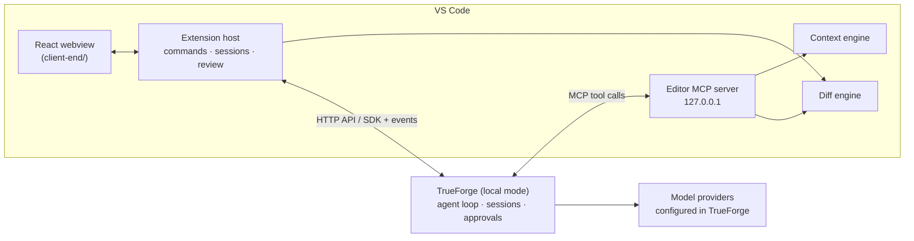

# FORGE

**Think. Understand. Engineer. Verify.**

FORGE is an AI software-engineering agent for Visual Studio Code. You describe a task in plain language; FORGE finds the relevant code in your repository, plans the change, edits several files, runs your tests, and shows every modification as a reviewable diff before anything touches disk. The agent loop runs on [TrueForge](https://github.com/truefoundry/trueforge) (TrueFoundry's open-source agent harness); FORGE is the editor-native client and tool provider.

> ### ⚠️ Project status — read this first
> **FORGE is in the design phase. No extension code exists yet.** The repository currently contains the engineering documentation and an unmodified Next.js starter in `client-end/`. Every capability below is marked **PLANNED** until [progress_tracker.md](progress_tracker.md) shows evidence otherwise. Sections that describe commands for unbuilt parts say so explicitly.
>
> **Frontend location:** the frontend lives in this repository at `/Users/aryansingh/Documents/QuantForge_IITB/client-end/`.
>
> Built for the **TrueFoundry Forge-a-thon, Techfest IIT Bombay 2026–27**.

**Documents:** [architecture.md](architecture.md) · [plan.md](plan.md) · [Ui-regitry.md](Ui-regitry.md) · [Agents.md](Agents.md) · [progress_tracker.md](progress_tracker.md)

## Contents
1. [Introduction](#1-project-introduction) · 2. [Why FORGE](#2-why-forge) · 3. [Features](#3-key-features) · 4. [Architecture](#4-architecture) · 5. [Tech stack](#5-technology-stack) · 6. [Prerequisites](#6-prerequisites) · 7. [Installation](#7-installation) · 8. [TrueForge setup](#8-trueforge-setup) · 9. [Development](#9-development-setup) · 10. [Structure](#10-project-structure) · 11. [Configuration](#11-configuration) · 12. [Security](#12-security) · 13. [Competition demo](#13-competition-demonstration) · 14. [Roadmap](#14-roadmap) · 15. [Limitations](#15-limitations) · 16. [Contributing](#16-contributing) · 17. [Licence](#17-licence-and-attribution) · 18. [Acknowledgements](#18-acknowledgements)

---

## 1. Project Introduction

- **Name:** FORGE
- **Tagline:** Think. Understand. Engineer. Verify.
- **What it is:** a VS Code extension that behaves like an engineering collaborator, not a chatbot. A developer states an outcome ("add a `config` CLI command, tested and documented"); the agent discovers the files, edits them, verifies, and presents hunks to accept or reject.
- **Value proposition:** (1) repository-aware context with *visible reasoning* about what was selected and why; (2) autonomous multi-file changes where you never name files; (3) the developer owns every write — no silent changes, per-hunk review, undo; (4) model independence and resilience, because models are configured in TrueForge and failures degrade gracefully.

## 2. Why FORGE?

| Common problem with AI coding assistants | How FORGE is designed to address it |
|---|---|
| **Incomplete repository understanding** — the model sees only what was pasted or the open file | Symbol- and dependency-aware retrieval (ripgrep + Tree-sitter + VS Code language services) behind agent-callable tools |
| **Poor context selection** — whole files are stuffed in until the window fills | Ranked, token-budgeted context with tiers (full → symbols → skeleton → path) and exclusion reasons |
| **Unsafe modifications** — edits land on disk before you've looked | Edits are *proposals*; only an approved review applies them, per hunk, with undo |
| **Limited multi-file reasoning** | A TrueForge-driven tool loop (search → read → plan → edit → test) with subagents for discovery |
| **Opaque execution** | Execution timeline, context inspector and the TrueForge session/turn/tool-call log |
| **Provider lock-in and fragility** | Models live in TrueForge; FORGE retries with backoff and can fall back to a second configured model |

## 3. Key Features

Status legend: ✅ available · 🟡 partial · 📐 planned. **Nothing is available yet.**

| Feature | Status | Description |
|---|---|---|
| Inline edit | 📐 | Select code, press `Cmd/Ctrl+Alt+K`, type an instruction, review an in-editor diff with per-hunk accept/reject |
| Autonomous agent mode | 📐 | One request drives a TrueForge agent through read/search/run/edit; changes ≥ 3 files without you naming them |
| Repository intelligence | 📐 | Tree-sitter symbols, import graph, ripgrep search; optional SQLite FTS5 index |
| Context inspector | 📐 | Shows selected files/symbols, why they were chosen, what was excluded, and the token budget |
| Diff review | 📐 | File and hunk diffs, accept/reject each, accept/reject all, undo, change explanations; approval-driven via TrueForge |
| Streaming | 📐 | Tokens and tool events stream from TrueForge; the editor never blocks |
| Cancellation | 📐 | Interrupt mid-run; workspace stays consistent, nothing half-applied |
| Model resilience | 📐 | Error classification, retry with exponential backoff, automatic fallback to another TrueForge model |
| Execution timeline | 📐 | Every tool call, command, test run, approval, retry and fallback in order |
| Next.js frontend scaffold | 🟡 | `client-end/` exists as the unmodified starter (type-check and lint pass) |

## 4. Architecture



TrueForge owns the loop and talks to models; FORGE hosts the editor tools and owns review and writes. Details, sequence diagrams and state machines: [architecture.md](architecture.md).

## 5. Technology Stack

"Planned" means chosen in [architecture.md](architecture.md) but not yet installed in this repository.

| Technology | Role | Status in repo |
|---|---|---|
| TypeScript (strict) | Primary language | Present in `client-end/` (`typescript ^5`) |
| VS Code Extension API | Editor integration | Planned |
| [TrueForge](https://github.com/truefoundry/trueforge) + `@truefoundry/trueforge-sdk` | Agent loop, sessions, turns, approvals, model access | Planned |
| MCP (`@modelcontextprotocol/sdk`) | Editor tool interface for the agent | Planned |
| React 19 | Webview UI | Present in `client-end/` (`react 19.3.0`) |
| Next.js 16 | Component gallery / mock-host harness | Present in `client-end/` (`next 16.4.6`, unmodified starter) |
| Tailwind CSS 4 | Styling via design tokens | Present in `client-end/` (`tailwindcss 4.3.3`) |
| shadcn/ui, Lucide | Primitives and icons | Planned |
| Tree-sitter (`web-tree-sitter`, WASM) | Symbol extraction, skeleton compression | Planned |
| ripgrep (`@vscode/ripgrep`) | Workspace search | Planned |
| SQLite + FTS5 | Optional persistent symbol index | Planned (optional, binding unresolved) |
| jsdiff (`diff`) | Diff and hunk generation | Planned |
| esbuild | Extension and webview bundling | Planned |
| Vitest · `@vscode/test-electron` + Mocha · Playwright | Unit · extension integration · UI tests | Planned |
| npm workspaces | Monorepo | Planned |

## 6. Prerequisites

| Requirement | Version / note |
|---|---|
| Node.js | **≥ 22.14** — verified requirement of TrueForge (per its README/quickstart). The audit machine runs Node v26.13.1 with npm 11.20.0 (works for the commands that were run). The range required by Next.js 16.4.6 was **not verified**. |
| npm | Ships with Node; lockfile is `client-end/package-lock.json` (npm) |
| VS Code | Required for the extension; the minimum version will be fixed in the extension's `engines.vscode` (**not yet determined**) |
| Git | Needed for the Flask fixture and for the review/shadow features |
| TrueForge | Run via `npx @truefoundry/trueforge@latest` (no install needed) |
| A model | Any provider/endpoint configured **inside TrueForge** (catalog provider or OpenAI-compatible endpoint, including a local model) |
| Python 3 + `pytest` | Only to run the competition demo tasks against Flask |

## 7. Installation

> The repository URL is not recorded in this checkout; replace `<repo-url>` with the public GitHub URL.

**What works today (frontend scaffold only):**

```bash
git clone <repo-url> QuantForge_IITB
cd QuantForge_IITB/client-end
npm ci
npm run lint            # verified on the audit machine (exit 0)
npx tsc --noEmit        # verified on the audit machine (exit 0)
npm run dev             # starts Next.js on http://localhost:3000 (not run during the audit)
```

**Planned (not available yet):** root `npm ci` for all workspaces, `npm run build`, packaging a `.vsix`. These scripts do not exist; see [plan.md Phase 0–1](plan.md#d-development-phases).

## 8. TrueForge Setup

All TrueForge facts below come from the official docs/README (read 2026-11-20); TrueForge was **not run** during the audit.

1. **Start TrueForge locally** (single process, SQLite, no other infrastructure):
   ```bash
   npx @truefoundry/trueforge@latest
   ```
   Open <http://localhost:8790>. Keep it on localhost — TrueForge documents local mode as personal-use with no login.
2. **Configure a model:** Settings → Models → pick a provider, paste the API key (or add a `custom` OpenAI-compatible provider with base URL + model IDs, e.g. a local server). Keys live only in TrueForge. For resilience, configure **two** models (primary + fallback).
3. **Register FORGE's editor tools (MCP):** TrueForge attaches MCP servers by URL under Settings → Connectors → *Add MCP Server*. FORGE's server listens on `127.0.0.1` with a bearer token shown by the command *FORGE: Show MCP Connection Details* (**planned**). Whether TrueForge accepts a loopback URL, and whether this can be automated through its API, is **unverified (spike S1)**.
4. **Load the FORGE agent definition:** `agents/forge-agent.json` and `agents/forge-inline-edit.json` (**planned; not yet in the repo**). The extension will register/refer to them through the SDK (`agents.create` / session `agent: { name | spec }`).
5. **Start an agent session:** open the FORGE sidebar → *Start new agent session* (planned). The session and its turns/tool calls also appear in TrueForge's own **Sessions** page.
6. **How the extension connects:** `forge.trueforge.baseUrl` (default `http://localhost:8790`) via `@truefoundry/trueforge-sdk`; the extension never calls a model provider.

## 9. Development Setup

**Today (frontend scaffold):** see §7. Before changing anything in `client-end/`, read `client-end/AGENTS.md` and the guides in `client-end/node_modules/next/dist/docs/` — this Next.js version has breaking changes relative to common knowledge.

**Planned (extension), once Phase 1 exists:**

| Step | Command (planned — will be confirmed against real `package.json` scripts) |
|---|---|
| Install | `npm ci` at the repo root |
| Build | `npm run build` |
| Run the extension | Open the repo in VS Code → *Run and Debug* → "Run Extension" (F5) → an **Extension Development Host** window opens with the FORGE Activity Bar icon |
| Unit tests | `npm test` (Vitest) |
| Extension tests | `npm run test:extension` (`@vscode/test-electron`) |
| UI tests | `npm run test:ui` (Playwright against the `client-end` harness) |
| Debug | Breakpoints in the extension host via the launch config; webview DevTools via *Developer: Open Webview Developer Tools* |

Contributors (human or AI) must follow [Agents.md](Agents.md) and update [progress_tracker.md](progress_tracker.md).

## 10. Project Structure

Only `client-end/` and the documents exist today; the rest is the target layout from [architecture.md §H](architecture.md#h-repository-structure).

```
QuantForge_IITB/
├─ README.md architecture.md plan.md Ui-regitry.md Agents.md progress_tracker.md   (exist)
├─ TrueFoundry_Forge-a-thon_compressed_UvvRJ9C (2).pdf   competition statement (exists)
├─ client-end/        frontend workspace — Next.js starter today; gallery + webview entry planned
├─ packages/          PLANNED: protocol · extension · trueforge-client · editor-mcp · context-engine · diff-engine
├─ agents/            PLANNED: TrueForge agent definitions + instructions
├─ config/            PLANNED: forge.example.json (no secrets)
├─ eval/              PLANNED: Flask 3.1.3 fixed-task scripts
└─ docs/              PLANNED: demo script, write-up source, spike notes
```

## 11. Configuration

**Planned** VS Code settings (names may change before release; defaults are targets). Never put API keys here — models and keys are configured in TrueForge.

```jsonc
// config/forge.example.json (PLANNED) — safe example, contains no credentials
{
  "forge.trueforge.baseUrl": "http://localhost:8790",
  "forge.model.primary": "<provider/model as named in TrueForge>",
  "forge.model.fallbacks": ["<second provider/model as named in TrueForge>"],
  "forge.context.budgetTokens": 24000,
  "forge.context.exclude": ["**/node_modules/**", "**/*.lock", "**/dist/**", "**/.env*"],
  "forge.stallTimeoutMs": 45000,
  "forge.review.autoOpenOnPause": true
}
```

If TrueForge hosted mode with login is ever used, the ID token is kept in VS Code SecretStorage, not in settings.

**Models used (competition requirement):** none yet — no model has been run. The write-up must list every model, where it ran, and approximate cost.

## 12. Security

- **Local-first:** TrueForge local mode, a loopback-only MCP server (bearer token, Origin check), no FORGE backend, no telemetry. Source code leaves the machine only through the model endpoint *you* configured in TrueForge (use a local OpenAI-compatible endpoint to keep it on-device).
- **Secrets:** FORGE stores none. `.env*`, keys and certificates are excluded from tools by default. Never commit keys; the repo ships an example config only.
- **Workspace boundaries:** every tool path is normalized, realpath-checked and confined to the workspace; symlink escapes and traversal are rejected; untrusted workspaces are read-only.
- **Tool approvals:** terminal commands require your approval *and* pass a default-deny allowlist; they run in a shadow copy where proposed edits are applied, not in your working tree.
- **Safe modifications:** the agent can only *propose* edits. Writing requires your explicit approval of the review (per hunk), re-checks file hashes first, applies atomically, and records an undo snapshot. FORGE keeps its own state outside your repo so a failed run leaves `git status` clean.
- **Untrusted content:** repository text and tool output are treated as data, not instructions (prompt-injection hardening; residual risks are listed in [plan.md §H](plan.md#h-risk-register)).

All of the above is **design intent** until implemented; see [architecture.md §F](architecture.md#f-security-and-safety).

## 13. Competition Demonstration

Fixture: `pallets/flask`, release tag **3.1.3** (commit `22d92470` per the competition statement; mapping to be verified). Start from a clean tree (`git status --porcelain` empty). Full scripts: [plan.md §G](plan.md#g-competition-validation).

**Task A — Inline edit.** Open `src/flask/helpers.py`, select `get_debug_flag`, trigger inline edit and enter:
> Treat the values 'off' and 'n' as false as well, case-insensitively, and update the docstring to list every value that is treated as false.

Accept the diff, then verify: `FLASK_DEBUG=off python -c "from flask.helpers import get_debug_flag; print(get_debug_flag())"` → `False`.

**Task B — Autonomous multi-file agent.** In the agent panel, mention no files and enter:
> Add a new built-in CLI command flask config that prints the loaded application's configuration as JSON, masking the values of any key containing SECRET, PASSWORD, TOKEN or KEY as "***". It must appear in flask --help, be covered by a test, and be documented alongside the other built-in commands.

Review and accept the hunks (≥ 3 files must change), then `pytest tests/test_cli.py -q` and run `flask --app <app> config` against any Flask app to show masked JSON. Show the TrueForge session (turns and tool calls).

**Task C — Resilience.** Configure TrueForge with an unreachable endpoint or invalid key, repeat Task A, and show: editor stays responsive; a clear error (or automatic fallback to a second configured model); `git status` shows no changed files.

**Status:** none of the three tasks has been run — see [progress_tracker.md](progress_tracker.md).

## 14. Roadmap

M0 setup & spikes → M1 TrueForge foundation → M2 MCP editor integration → M3 inline edit → M4 diff review & safety → M5 autonomous agent → M6 context intelligence → M7 streaming & cancellation → M8 resilience & fallback → M9 UI polish & integration tests → M10 competition demonstration and submission. Detail, dependencies and acceptance criteria: [plan.md](plan.md); live status: [progress_tracker.md](progress_tracker.md). Currently in **M0 (in progress)**.

## 15. Limitations

Honest list as of 2026-11-20:
- **No product code exists** — all features are planned.
- TrueForge integration points are unverified until the spikes run (loopback MCP registration, error payload shapes, health endpoint).
- TrueForge documents automatic model selection as *roadmap*; FORGE's fallback is therefore its own orchestration of new TrueForge sessions, which cannot carry over TrueForge-internal state.
- VS Code has no stable inline-diff API for extensions; FORGE's in-editor diff will use decorations, CodeLens and the native diff editor, which is less polished than a first-party surface.
- Retrieval is lexical/structural first; purely semantic queries may need more agent iterations. Embeddings are optional and not planned for v1.
- Python and TypeScript/JavaScript are the first target languages.
- Shadow-workspace verification may not reproduce every environment (editable installs, native deps); a degraded post-accept verification mode is the fallback.
- Competition timing: the Round 1 deadline in the statement is 20 Nov 2026 23:59 IST; see [progress_tracker.md](progress_tracker.md) blocker B1.

## 16. Contributing

1. Read [Agents.md](Agents.md) (applies to humans too), then [architecture.md](architecture.md), [plan.md](plan.md), [Ui-regitry.md](Ui-regitry.md).
2. Pick a backlog item from [plan.md §E](plan.md#e-engineering-backlog) whose dependencies are done; one item per change.
3. TypeScript strict, small modules, tests with every change, no secrets, no unrelated edits.
4. Keep the six documents consistent; update [progress_tracker.md](progress_tracker.md) with evidence.
5. Definition of Done: [plan.md §I](plan.md#i-definition-of-done).
6. Never add direct model-provider calls, a second agent loop, or silent writes.

## 17. Licence and Attribution

- **FORGE licence:** **not yet chosen — there is no `LICENSE` file.** The competition requires a public repository under an open-source licence (backlog FORGE-066, P0). Until a `LICENSE` is added, the code has no granted licence.
- **Fork point:** **from scratch** — no upstream editor project (Cline, Continue, Roo Code, opencode, …) has been forked or copied. The frontend starts from the `create-next-app` template (Next.js and its dependencies are open-source; their licences ship inside `client-end/node_modules/*`). If code is ever reused from another project, this section must list the upstream repository URL and exact commit, preserve its licence, and describe the delta.
- **TrueForge** is MIT-licensed (verified from its repository) and used as an external runtime/SDK dependency, not vendored.
- **Flask** (`pallets/flask`) is used only as an external test fixture for the demo; it is cloned separately, not vendored, and keeps its own licence.

## 18. Acknowledgements

- [TrueFoundry](https://www.truefoundry.com/) for TrueForge and the Forge-a-thon; [Techfest, IIT Bombay](https://techfest.org/) for hosting.
- Open-source projects FORGE builds on or is informed by: TrueForge, Model Context Protocol, VS Code, Tree-sitter, ripgrep, SQLite, React, Next.js, Tailwind CSS, shadcn/ui, Lucide, jsdiff, esbuild, Vitest, Playwright; and the editor-agent community projects (Cline, Continue, Roo Code, opencode) whose public work set the bar — none of their code is used.
