# QuantForge — Architecture

> **Status of this document:** design of record. Nothing described here is implemented yet unless [progress_tracker.md](progress_tracker.md) says so with evidence.
> **Frontend location:** all frontend code lives in this repository at `/Users/aryansingh/Documents/QuantForge_IITB/`, in the `client-end/` workspace (see [§H](#h-repository-structure) and ADR-009).
> **Related:** [plan.md](plan.md) (sequence) · [Ui-regitry.md](Ui-regitry.md) (UI) · [Agents.md](Agents.md) (rules for AI contributors) · [README.md](../README.md) · [progress_tracker.md](progress_tracker.md)

> **Competition source of truth:** `TrueFoundry_Forge-a-thon_compressed_UvvRJ9C (2).pdf` in the repository root (Techfest 2026-27 problem statement, read 2026-11-20). Its scoring rubric (A1–C2) is mapped to modules in [plan.md §A](plan.md#a-product-objectives).

Terminology used across all six documents: **Extension Host** (the VS Code Node process running QuantForge), **Webview** (React UI), **TrueForge** (agent runtime, owns the loop), **Editor MCP Server** (tools the agent calls), **Context Engine**, **Diff Engine**, **Proposal** (an edit suggested by the agent, not yet on disk), **Hunk**, **Review Queue**, **Review Gate** (the approval-gated `submit_changes` call), **Shadow Workspace**.

---

## A. Architecture Overview

### A.1 Principles

1. **TrueForge owns the agent loop.** QuantForge never calls a model provider and never runs its own plan→act→observe loop. It creates TrueForge sessions, sends turns, renders streamed events, and answers tool calls.
2. **The agent decides; the editor obeys.** Editor capabilities (read, search, symbols, diagnostics, git, terminal, edit proposals) are MCP tools. The extension does not pre-select files for the agent beyond what the user explicitly `@mention`ed.
3. **No silent writes.** The only code path that writes workspace files is `DiffEngine.apply()`, invoked only by a user accept action.
4. **Local-first.** Everything runs on the developer's machine: VS Code, TrueForge local mode (`npx @truefoundry/trueforge@latest`, SQLite), a localhost MCP server. No QuantForge backend, database, or account system.
5. **Model-independent.** Models are TrueForge configuration (`provider/model` names). QuantForge stores model *names*, never keys.

### A.2 Component view

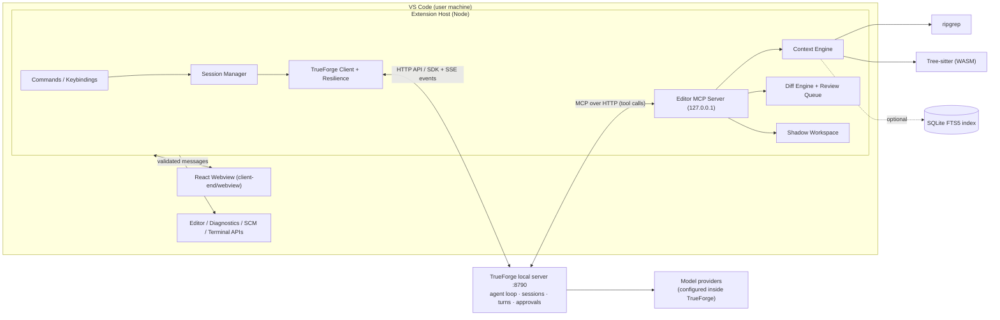

### A.3 Who owns what

| Concern | TrueForge owns | QuantForge owns |
|---|---|---|
| Agent loop (plan, tool choice, iteration) | ✅ | ❌ never |
| Model calls, provider credentials, model catalog | ✅ | ❌ (stores model *names* only) |
| Sessions, turns, event log, persistence (SQLite) | ✅ | Holds ids, renders events |
| Context compaction of conversation history | ✅ (default on) | — |
| Tool approval pause/resume protocol | ✅ (`tool.approval_required` → `user.tool_approval`) | Renders the prompt (terminal command or diff review), sends the decision |
| Turn cancellation (`sessions.cancel`) | ✅ | Triggers it; makes tool handlers abortable |
| Editor tools (MCP server) and their safety checks | ❌ | ✅ |
| Repository retrieval and ranking (behind `get_context`, `find_symbol`, …) | ❌ | ✅ |
| Diff generation, hunk review, apply, undo | ❌ | ✅ |
| Retry/backoff and model fallback orchestration | Partially: TrueForge lists *automatic model selection* as roadmap, not shipped | ✅ ([§B.7](#b7-model-resilience), ADR-006) |
| UI | Bundled chat UI exists but is not used | ✅ React webview |

> Source for TrueForge capabilities: the TrueForge repository docs (`docs/api/use-agent.mdx`, `docs/create-agent/overview.mdx`, `docs/mcp-servers.mdx`, `docs/roadmap.mdx`), read 2026-11-20. Items not confirmed there are listed as **spikes** in [plan.md](plan.md#phase-0--repository-audit-and-setup) and must be verified before dependent code is written.

### A.4 Competition eligibility mapping

| Eligibility requirement | Where satisfied |
|---|---|
| TrueForge owns the agent loop | A.1 #1; ADR-001; [Agents.md §D](Agents.md) forbids a second loop |
| Extension talks to TrueForge via HTTP API/TS SDK | `packages/trueforge-client` wraps `@truefoundry/trueforge-sdk` ([§B.3](#b3-trueforge-integration)) |
| Editor capabilities exposed through MCP | `packages/editor-mcp` ([§B.4](#b4-mcp-tool-layer)) |
| Agent decides tools/files | Tools are pull-based; no extension-side file preselection beyond user `@mentions` |
| Models configured through TrueForge | Settings hold `provider/model` names only; [§B.7](#b7-model-resilience) |
| No direct provider calls from extension | Enforced by lint rule + CI grep ([plan.md FORGE-015](plan.md#e-engineering-backlog)) |
| TrueForge local mode | Default `baseUrl` `http://localhost:8790` |
| Agent definition in repo | `agents/forge-agent.json`, `agents/forge-inline-edit.json` (planned) |
| Editor capabilities (read, search, propose a write, run a command) are MCP tools | [§B.4](#b4-mcp-tool-layer) |
| TrueForge tool approval drives diff review (rubric B4 ≥ 7) | `submit_changes` Review Gate, ADR-014 |
| At least one TrueForge context-engineering feature, visible in the session (rubric B4 = 10) | Subagents (discovery), deferred tool loading, compaction; [§B.3](#b3-trueforge-integration), ADR-015 |
| Declared fork point, upstream licence preserved | From scratch (no upstream editor project adopted yet); any later reuse must be declared with repo URL + commit ([README](../README.md#17-licence-and-attribution)) |
| Never commit keys; ship example config | `config/forge.example.json` (planned, FORGE-068) |
| Sessions, turns, tool calls demonstrable | TrueForge Sessions UI + QuantForge Execution Timeline ([Ui-regitry.md §D.6](Ui-regitry.md)) |

---

## B. System Components

### B.1 Extension Host

Package: `packages/extension` (planned). Responsibilities:

| Area | Detail |
|---|---|
| Activation | `onStartupFinished` is avoided; activate on `onView:forge.sidebar`, `onCommand:forge.*`. Cold activation target < 300 ms (target, not measured). |
| Commands | `forge.inlineEdit`, `forge.openAgent`, `forge.newSession`, `forge.cancel`, `forge.review.acceptAll`, `forge.review.rejectAll`, `forge.review.undo`, `forge.startTrueForge`, `forge.openSettings`. |
| Keybindings | Inline edit: `Cmd+Alt+K` (macOS) / `Ctrl+Alt+K` (Win/Linux), `when: editorTextFocus && editorHasSelection`. Chosen to avoid the `Cmd+K` chord prefix. User-rebindable. |
| Workspace integration | `vscode.workspace`, `WorkspaceEdit`, `TextDocument` change events (for stale-proposal detection), `vscode.git` extension API for status. |
| Session lifecycle | `SessionManager` maps QuantForge sessions ↔ TrueForge `session.id`, persists ids in `ExtensionContext.workspaceState`, resumes after reload via `subscribeToTurn` (see [§E](#e-state-management)). |
| Webview messaging | One `WebviewViewProvider` (sidebar) and optional panel; all messages validated against `packages/protocol` zod schemas in both directions. CSP with nonce, no remote content. |
| Hosting | Starts the Editor MCP Server on `127.0.0.1:<ephemeral>` with a per-activation bearer token. |

The extension host is the **only** component that imports `vscode`. `context-engine`, `diff-engine`, and `protocol` must stay `vscode`-free so they are unit-testable under Vitest.

### B.2 Webview UI

Package: `client-end/` (existing Next.js scaffold; webview entry planned in `client-end/webview/`). See ADR-009 for how the Next.js app and the webview bundle coexist.

Responsibilities: conversation + streaming text, execution timeline, context inspector, plan viewer, diff review, model status, settings. It holds **no** business logic: it renders state pushed from the extension host (a single `AppState` snapshot + incremental events) and emits user intents. Full spec in [Ui-regitry.md](Ui-regitry.md).

Message contract (excerpt; the authoritative schemas live in `packages/protocol`):

```ts
// Webview -> Host
type WebviewToHost =
  | { type: 'task.submit'; text: string; mentions: Mention[] }
  | { type: 'turn.cancel'; sessionId: string }
  | { type: 'approval.decide'; callId: string; decision: 'allow' | 'deny'; reason?: string }
  | { type: 'review.hunk'; proposalId: string; hunkId: string; action: 'accept' | 'reject' }
  | { type: 'review.bulk'; action: 'acceptAll' | 'rejectAll' | 'undo'; batchId?: string }
  | { type: 'settings.update'; patch: Partial<ForgeSettings> }
  | { type: 'ready' };

// Host -> Webview
type HostToWebview =
  | { type: 'state.snapshot'; state: AppState }
  | { type: 'timeline.event'; event: TimelineEvent }
  | { type: 'stream.delta'; turnId: string; threadId: string; text: string }
  | { type: 'review.updated'; queue: ReviewQueueState }
  | { type: 'error.notify'; error: UserFacingError };
```

Every envelope carries `{ v: 1, id: string }`; unknown `type` or failed validation is dropped and logged, never executed.

### B.3 TrueForge Integration

Package: `packages/trueforge-client` (planned), a thin wrapper over **`@truefoundry/trueforge-sdk`** (npm; TypeScript client documented by TrueForge). Verified-from-docs surface used:

| Need | SDK call (from TrueForge docs) |
|---|---|
| Connect | `new TrueForge({ baseUrl, timeoutInSeconds })` — default local `baseUrl` `http://localhost:8790`; no token in local mode |
| Create session | `client.sessions.create({ agent: { name } })` or `{ agent: { spec } }` (inline spec) |
| Stream a turn | `client.sessions.createTurnStream(sessionId, { input: [{ type: 'user.message', content }] })` |
| Cancel | `client.sessions.cancel(sessionId)` — aborts the in-flight model request, waits for running MCP tool calls, force-stops sandbox |
| Resume after disconnect | `getTurn`, `subscribeToTurn(sessionId, turnId, { fromEventId })`, `listTurnEvents` |
| Approvals | respond with `user.tool_approval` input (`{ status: 'allow' } \| { status: 'deny', reason }`) |
| Save agent | `client.agents.create(...)` → `POST /api/v1/agents` (name unique, immutable) |
| Capabilities / health | `GET /api/v1/capabilities` (documented endpoint; used as the reachability probe — **spike S2** confirms) |

Events consumed (documented): `turn.created`, `turn.update` (`paused`/`running`), `turn.done` (`done` \| `cancelled` \| `error`), `model.message`, `model.message.delta`, `tool.response`, `tool.approval_required`, `tool.response_required`, `thread.created`, `thread.done`, `mcp.initialize`, `mcp.auth_required`.

**QuantForge-side responsibilities:** (1) `EventNormalizer` converts SDK events into `TimelineEvent`s; (2) `SessionManager` persistence and resume; (3) agent definition loading from `agents/*.json` and registration; (4) error classification feeding [§B.7](#b7-model-resilience); (5) one in-flight turn per session (TrueForge cancels the previous turn when a new message arrives, so the client serializes sends deliberately).

**Agent definitions** (planned, in-repo, loaded by `SessionManager`): `agents/forge-agent.json` (autonomous mode) and `agents/forge-inline-edit.json` (restricted tool set, short iteration limit). Shape follows the documented agent spec:

```json
{
  "model": { "name": "<provider/model configured in TrueForge>", "params": { "temperature": 0.2 } },
  "instructions": "<contents of agents/forge-agent.instructions.md>",
  "mcp_servers": [{
    "name": "forge-editor",
    "enable_tools": ["@all"],
    "require_approval_for_tools": ["run_terminal", "submit_changes"],
    "preload_tools": ["get_context", "read_file", "search_workspace", "find_symbol", "propose_edit", "run_terminal", "submit_changes", "update_plan"]
  }],
  "config": {
    "sandbox": { "enabled": false },
    "ask_user_questions": { "enabled": true },
    "dynamic_sub_agents": { "enabled": true },
    "context_management": {
      "compaction": { "enabled": true },
      "large_tool_response": { "enabled": true }
    },
    "iteration_limit": 60
  }
}
```

**TrueForge context-engineering features used (rubric B4):** *deferred tool loading* (`preload_tools` lists the 8 essential tools; `get_file_structure`, `get_diagnostics` and `get_git_status` are offered through TrueForge's `list_tools`/`call_tool` indirection, visible in the session); *subagents* (`dynamic_sub_agents`; the instructions direct the agent to delegate broad discovery — "find every file relevant to X" — to a subagent so the main thread's context stays small; visible as `thread.created`/`thread.done` events); *compaction* and *large tool response offloading* (documented defaults, set explicitly). *Code Mode* and skills require the optional sandbox and are not used (ADR-015). `sandbox` stays disabled, which the rules permit.

The model name is a placeholder; the real value comes from the user's TrueForge configuration (`forge.model.primary`). The inline-edit agent sets `enable_tools` to `["read_file","get_file_structure","find_symbol","get_diagnostics","propose_edit","submit_changes"]`, disables subagents, and uses `iteration_limit` ≈ 12 (target).

> **Integration points — verified 2026-11-20 against real TrueForge (local mode):** loopback MCP registration works once TrueForge is started with `OUTBOUND_URL_ALLOWED_HOSTS='["127.0.0.1"]'` (its SSRF guard blocks loopback otherwise) and is scriptable via `POST /api/v1/settings/mcp-servers`; `GET /api/v1/capabilities` is the reachability probe; an inline `agent.spec` can reference the registered server by name; model failures arrive as `turn.done` `state.status:"error"` with `[Model Error] Request failed (NNN): …` / `Cannot connect to API: …`. Details and remaining unknowns: [§K](#k-implementation-notes-verified-findings).

### B.4 MCP Tool Layer

Package: `packages/editor-mcp` (planned). An MCP server (Streamable HTTP transport, official `@modelcontextprotocol/sdk`) hosted inside the Extension Host. TrueForge connects to it as a *remote* MCP server (its connector model is URL + optional header auth, per TrueForge docs). Auth: `Authorization: Bearer <token>` generated per activation, shown to TrueForge via connector config. Binds `127.0.0.1` only.

Each tool declares MCP annotations (`readOnlyHint`, `destructiveHint`) so TrueForge's default approval policy (`@write`, `@destructive`) is meaningful; QuantForge additionally lists `run_terminal` by name in `require_approval_for_tools` because unlabeled tools are *not* covered by the label policy.

**Common rules for every tool:** inputs validated with zod (strict objects); all paths resolved via `resolveWorkspacePath()` (realpath, must be inside a workspace folder, no symlink escape, deny-list for `.git/` and secrets files); outputs structured JSON plus short text; every handler accepts an `AbortSignal` tied to cancellation; output size capped (default 64 KB, truncation flagged `truncated: true`); errors returned as `{ ok: false, error: { code, message, hint? } }` — never thrown across the transport.

Shared types:

```ts
type Path = string;                    // workspace-relative, POSIX separators
type Range = { startLine: number; endLine: number }; // 1-based, inclusive
type ToolError = { code: 'PATH_OUTSIDE_WORKSPACE'|'NOT_FOUND'|'DENIED'|'TOO_LARGE'|'TIMEOUT'|'CANCELLED'|'INVALID_INPUT'|'STALE_BASE'|'INTERNAL'; message: string; hint?: string };
```

| Tool | Description | Input | Output | Permission class | Error cases | Safety restrictions |
|---|---|---|---|---|---|---|
| `read_file` | Read a file or line range | `{ path: Path; range?: Range }` | `{ ok, path, content, totalLines, range, encoding, truncated, contentHash }` | read | `NOT_FOUND`, `PATH_OUTSIDE_WORKSPACE`, `TOO_LARGE` (> 512 KB without range), binary file | Secret-pattern files (`.env*`, `*.pem`, `id_rsa*`) denied unless user allow-lists; content returned inside a data envelope (see [§F](#f-security-and-safety)) |
| `search_workspace` | Text/regex search via ripgrep | `{ query: string; regex?: boolean; glob?: string[]; caseSensitive?: boolean; maxResults?: number (≤200) }` | `{ ok, matches: { path, line, preview, score }[], truncated }` | read | `INVALID_INPUT` (bad regex), `TIMEOUT` (5 s default) | Honors `.gitignore` and `forge.context.exclude`; no `--follow` symlinks; no `--no-ignore` |
| `find_symbol` | Locate definitions/references by name | `{ name: string; kind?: 'function'\|'class'\|'method'\|'variable'\|'any'; includeReferences?: boolean; path?: Path }` | `{ ok, symbols: { name, kind, path, range, signature, container?, doc? }[], references?: { path, line }[] }` | read | `NOT_FOUND` (empty list is *not* an error), `TIMEOUT` | Tree-sitter index first, `vscode.executeWorkspaceSymbolProvider`/`executeReferenceProvider` as enrichment; both bounded |
| `get_file_structure` | Outline of a file (symbols, imports) or directory tree | `{ path: Path; depth?: number (≤4) }` | file: `{ symbols[], imports[], lineCount }`; dir: `{ entries[] }` | read | `NOT_FOUND`, `PATH_OUTSIDE_WORKSPACE`, unsupported language → imports/symbols empty with `parsed: false` | Directory listing excludes ignored/vendor paths |
| `get_context` *(QuantForge addition)* | Ranked, budgeted context bundle for a query | `{ query: string; mentions?: Mention[]; budgetTokens?: number; focusPaths?: Path[] }` | `{ ok, items: { path, range?, tier: 'full'\|'symbols'\|'skeleton'\|'path', tokens, score, reasons: string[] }[], excluded: { path, reason }[], usedTokens, budgetTokens }` | read | `TIMEOUT`, `INVALID_INPUT` | Never returns more than `budgetTokens`; reasons are user-visible in the Context Inspector |
| `propose_edit` | Submit a change to a file (does **not** write) | `{ path: Path; baseHash: string; edits: { range: Range; newText: string }[] \| { newContent: string }; rationale: string; create?: boolean; delete?: boolean }` | `{ ok, proposalId, status: 'queued', hunks: number, linesAdded, linesRemoved }` | propose (queue only; not gated) | `STALE_BASE` (file changed since read), `NOT_FOUND`, `DENIED` (protected path), `INVALID_INPUT` (overlapping edits) | Writes only into the in-memory Review Queue; never touches disk or the editor buffer; `baseHash` must match the last `read_file` hash of that path |
| `verify_changes` *(QuantForge addition — completeness gate)* | Prove every requirement of the task is covered: map each to an EXACT line you added; `submit_changes` is declined until this passes | `{ checklist: { requirement: string; evidence: string }[] }` (1–20 items) | `{ ok, verified:true, covered:[{requirement,path}] }` or `INVALID_INPUT` listing uncovered requirements | read (marks the queue verified; no workspace effect) | `NOT_FOUND` (nothing queued), `INVALID_INPUT` (evidence not among added lines, or two requirements share one line) | Evidence must match an added line (removed lines count only for remove/delete requirements); whitespace/case-insensitive, ≥80 % token overlap tolerated; invalidated by any later `propose_edit` |
| `submit_changes` *(QuantForge addition — the Review Gate)* | Ask the human to review and apply the queued proposals; **the call is approval-gated by TrueForge** | `{ summary: string; proposalIds?: string[] }` (default: all queued in this turn) | `{ ok, decision: 'applied'\|'partially_applied'\|'rejected', applied: { proposalId, hunkId }[], rejected: { proposalId, hunkId, reason? }[], batchId }` | **write — approval required** (listed by name in `require_approval_for_tools`; also labeled `destructiveHint: true`) | `NOT_FOUND` (nothing queued), `STALE_BASE`, `CANCELLED` | The turn pauses on `tool.approval_required`; the extension shows Diff Review with the diff, summary and per-hunk controls. *Allow* = apply the hunks the user accepted (atomic batch, undo snapshot) and return the result to the agent; *Deny* = reject all, return reasons so the agent can revise. This is the **only** tool that can cause a workspace write, and only after a human decision |
| `run_terminal` | Run a command in the Shadow Workspace | `{ command: string; cwd?: Path; timeoutMs?: number (≤120000); reason: string }` | `{ ok, exitCode, stdout, stderr, durationMs, truncated, ranIn: 'shadow'\|'workspace' }` | **execute — approval required** | `DENIED` (policy), `TIMEOUT`, `CANCELLED` | Default-deny policy ([§F.3](#f3-terminal-execution-policy)); runs in the Shadow Workspace where pending proposals are applied; never in the real tree unless the user opts in per command; process group killed on cancel; env scrubbed of `*_KEY`, `*_TOKEN`, `*_SECRET` |
| `get_diagnostics` | Problems for files from VS Code (language servers) | `{ paths?: Path[]; severity?: 'error'\|'warning'\|'all' }` | `{ ok, diagnostics: { path, range, severity, message, source, code? }[] }` | read | `PATH_OUTSIDE_WORKSPACE` | Reports diagnostics for on-disk state; proposals are not reflected (documented limitation) |
| `get_git_status` | Branch, changed files, optional diff stat | `{ includeDiffStat?: boolean }` | `{ ok, branch, head, changed: { path, status }[], diffStat? }` | read | `NOT_A_REPO` (as `NOT_FOUND`) | Read-only via `vscode.git` API or `git status --porcelain`; no write verbs exposed |
| `update_plan` *(QuantForge addition)* | Publish/update the task plan for the Plan Viewer (UI-only; no workspace effect) | `{ steps: { id: string; title: string; status: 'pending'\|'in_progress'\|'done'\|'skipped'; files?: Path[]; dependsOn?: string[] }[] }` | `{ ok: true }` | read (no side effects beyond UI) | `INVALID_INPUT` (> 30 steps, duplicate ids) | Never touches files; strings length-capped and rendered as plain text |

The agent invokes tools freely subject to the approval policy; the extension never calls these tools itself. If a turn ends with queued proposals but without a `submit_changes` call (a weak or confused model), the extension opens the same review UI locally as a safety net; the decision path and guarantees are identical, only TrueForge's approval pause is absent (the timeline marks it *local review*).

### B.5 Context Engine

Package: `packages/context-engine` (planned; no `vscode` import — the host injects a `WorkspaceFacade` for file access, LSP queries, and open-editor info).

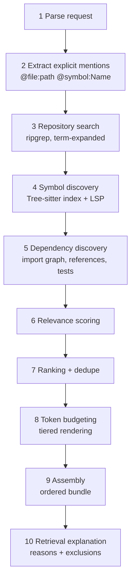

**Entry points.** (a) *Explicit mentions* typed by the user are resolved in the extension *before* the turn and attached to the user message as a clearly delimited data block — this is user intent, not agent decision. (b) *Everything else* is pulled by the agent through `get_context`, `search_workspace`, `find_symbol`, `get_file_structure`, `read_file`. The same engine serves all of them.

| Stage | Method |
|---|---|
| 1 Parse | Extract identifiers, quoted strings, file-like tokens, and verbs from the request; derive query terms and lightweight synonyms (e.g. `config` → `config`, `Config`, `app.config`). Pure string work; no model call. |
| 2 Mentions | `@file:src/flask/cli.py`, `@symbol:get_debug_flag`, plus `@src/flask/cli.py` shorthand from the composer autocomplete. Unresolvable mentions surface as inline errors, never silently dropped. Mentioned items get score 1.0 and are non-evictable up to 50% of the budget. |
| 3 Search | `ripgrep` (npm `@vscode/ripgrep` binary) with `--json`, `.gitignore` honored, per-term searches merged. Hits scored by term coverage and match density. |
| 4 Symbols | Tree-sitter via `@vscode/tree-sitter-wasm` (WASM — avoids per-Electron-ABI native rebuilds) extracts definitions/imports for **Python and TypeScript/JavaScript first** (Flask demo is Python). LSP enrichment uses the stable commands `vscode.executeWorkspaceSymbolProvider`, `executeDocumentSymbolProvider`, `executeDefinitionProvider`, `executeReferenceProvider`. |
| 5 Dependencies | Import graph from Tree-sitter (importers and imports, depth ≤ 2), reference sites from LSP, and test affinity (`tests/test_<module>.py`, `*.test.ts`). Used to pull neighbors of high-scoring files. |
| 6 Scoring | `score = 1.0·mention + 0.45·textMatch + 0.35·symbolNameMatch + 0.25·graphProximity(1/(1+hops)) + 0.10·testAffinity + 0.10·recency(open/modified) − 0.5·lowValuePenalty` clipped to [0,1]. Weights are **initial targets**, tuned against the fixed tasks ([plan.md §G](plan.md#g-competition-validation)). Low-value: lockfiles, minified, generated, vendored, snapshots. |
| 7 Rank | Sort by score; dedupe overlapping ranges; cap per-file contribution. |
| 8 Budget | Token estimate = `ceil(chars/4)` (no tokenizer dependency; conservative margin 10%). Budget default is a setting (`forge.context.budgetTokens`) and is also capped by the active model's context length when TrueForge reports it. Each candidate has a **tier ladder**: `full` → `symbols` (only matching symbol bodies + signatures) → `skeleton` (signatures + docstrings, bodies elided via Tree-sitter) → `path` (listed only). Greedy fill by score density; downgrade a tier rather than drop when budget is tight. |
| 9 Assemble | Items ordered: mentions, high-score full items, symbol slices, skeletons, path list. Each item has a header with path, range, and `contentHash`. |
| 10 Explain | Each item carries `reasons[]` (e.g. `"mentioned by user"`, `"matches 'get_debug_flag' (3 hits)"`, `"imported by cli.py"`) and exclusions carry reasons (`"over budget"`, `"ignored by .gitignore"`, `"lockfile"`). The Context Inspector shows this verbatim. |

**Large repositories.** The engine never concatenates the repository. It works from an *index of the repository* (paths, symbol tables, import edges — a few KB per hundred files) and only materializes text for items that survive ranking within the budget. TrueForge separately compacts conversation history and offloads large tool responses (documented defaults), which complements — not replaces — QuantForge's per-request budgeting.

**Indexing tiers.**
1. *Tier 0 — on-demand* (default MVP): ripgrep + per-file Tree-sitter parse cached in memory keyed by `mtime+size`. No persistent index.
2. *Tier 1 — persistent symbol index* (optional): SQLite with FTS5 storing symbols/imports, updated incrementally from `FileSystemWatcher` events. Binding choice is **spike S5** (native `better-sqlite3` requires Electron-matched rebuilds; `node:sqlite` availability depends on the Electron Node version; WASM SQLite must be confirmed to ship FTS5). Tier 1 is gated behind a setting and never required.
3. *Tier 2 — embeddings* (optional, P3): off by default; if added, embedding calls must also route through TrueForge-configured models or run locally; never a direct provider call from the extension.

### B.6 Diff Engine

Package: `packages/diff-engine` (planned, `vscode`-free) plus the review UI adapters in the extension.

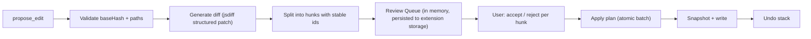

- **Proposed edits.** `propose_edit` accepts range edits or whole-file content (create/delete allowed). The engine normalizes to a *base text* (verified by `baseHash`) and a *proposed text*. Multiple proposals for one file are chained; a later proposal must be based on the previous proposed text (the agent re-reads through the shadow-aware `read_file`, which returns *proposed* content with a `contentHash` of that state).
- **Diff generation / hunks.** Structured patch via the `diff` npm package (jsdiff), context 3 lines. Hunk ids are `sha1(path + baseHash + hunkIndex + oldRange)`; stable across re-renders.
- **Review state.** Per hunk: `pending | accepted | rejected | applied | conflicted | undone`. Per proposal and per batch (one agent turn = one batch) states are derived.
- **Accept/reject.** The user marks hunks accepted/rejected in the review UI (webview or editor CodeLens). **Applying** is triggered by answering the `submit_changes` approval (*Allow* applies exactly the accepted hunks; *Deny* / Reject All applies none) or, for the local-review safety net, by the Apply button. Accept All / Reject All operate on the whole batch. Nothing is applied by merely marking a hunk.
- **Applying.** Compute the final text per file by applying accepted hunks onto the *current* on-disk/buffer text with a 3-way merge (base, current, proposed-accepted). Any hunk that does not apply cleanly is marked `conflicted` and left for the user. Writes go through `vscode.workspace.applyEdit(WorkspaceEdit)` so the editor's own undo stack and dirty-buffer handling stay correct; for non-open files the edit still goes through `WorkspaceEdit` (VS Code handles file IO). A batch is all-or-nothing at the `WorkspaceEdit` level: `applyEdit` returns `false` → nothing is marked applied.
- **Undo.** Before apply, the engine records `{ batchId, path, preText, preHash }`. `forge.review.undo` restores pre-text *only if* the file still equals the post-apply hash; otherwise it shows a conflict and offers a diff. The snapshot log persists to the extension's per-workspace storage directory (`ExtensionContext.storageUri`, outside the workspace) so undo survives reload.
- **Concurrent modification.** Subscribe to `onDidChangeTextDocument` and `FileSystemWatcher`; any proposal whose `baseHash` no longer matches the current text flips to `stale` and requires re-base (3-way merge attempt) before accept. Dirty unsaved buffers are the source of truth over disk.
- **Workspace consistency.** Multi-file batches apply in one `WorkspaceEdit`; deletes/creates are included in it. If the extension host dies mid-apply, startup reconciliation compares undo-journal entries to on-disk hashes and offers recovery.
- **Inline editor presentation.** VS Code's extension API has no stable inline-diff surface (the built-in inline chat diff is not available to extensions). QuantForge therefore renders: `TextEditorDecorationType` (added lines highlighted, removed lines shown as virtual `before`/line decorations), `CodeLensProvider` per hunk (`Accept` · `Reject`), and a `TextDocumentContentProvider` with scheme `forge-proposed:` for `vscode.diff` side-by-side file review. Hunk-level review inside the webview mirrors the same state.
- **Change summaries.** Each proposal carries the agent's `rationale`; the UI aggregates files/hunks/+/− counts. QuantForge does not call a model to summarize; the agent supplies the rationale in `propose_edit`.

**Shadow Workspace** (supports verification without writing): a checkout in `<storageUri>/shadow/<sessionId>/` (outside the workspace, so `git status` in the user's repo is never affected) (git worktree when the folder is a git repo, otherwise a filtered copy) with *pending proposals applied*. `run_terminal` and the verification flow run here, so tests exercise proposed code while the real tree stays untouched. Ignored environment directories (e.g. `.venv`, `node_modules`) are symlinked read-only; Python invocations get `PYTHONPATH` pointing at the shadow's source roots so editable installs do not import the original tree. **Spike S6** validates this on Flask 3.1.3 (editable install + `pytest tests/test_cli.py`). If it fails, fallback: run in the real tree only after the user accepts the batch (documented as degraded: tests run post-accept, undo available).

### B.7 Model Resilience

All model access is through TrueForge. QuantForge adds *orchestration around failures*; it does not add a second agent loop or any provider code (ADR-006).

| Aspect | Design |
|---|---|
| Model configuration | `forge.model.primary` and ordered `forge.model.fallbacks[]`, each a TrueForge model name (`provider/model`). Providers/keys/custom endpoints are configured in TrueForge Settings → Models. QuantForge validates names against what TrueForge reports where an endpoint exists (spike S2) and otherwise surfaces the first failing turn. |
| Failure detection | Classified from (1) SDK/HTTP errors reaching TrueForge (`ECONNREFUSED`, timeout → **`TRUEFORGE_UNREACHABLE`**); (2) `turn.done` with `status: "error"` and its `message` (auth 401/403 → **`MODEL_AUTH`**, 429 → **`MODEL_RATE_LIMIT`**, 5xx/network → **`MODEL_UNAVAILABLE`**) — message parsing is heuristic until **spike S4** captures real payloads; (3) stream stall (no event for `forge.stallTimeoutMs`, default 45 000 ms) → **`STALLED`**. |
| Retry | Retry only `MODEL_RATE_LIMIT`, `MODEL_UNAVAILABLE`, `STALLED`. Exponential backoff with full jitter: `delay = random(0, min(8s, 500ms·2^attempt))`, max 3 attempts, honoring `Retry-After` when exposed. Never retry `MODEL_AUTH`. A retry re-sends the turn input to a **fresh turn**; because only proposals (never disk writes) result from a failed turn, retry is safe. |
| Fallback | After retries (or immediately on `MODEL_AUTH`), switch to the next name in `fallbacks[]`: create a **new TrueForge session** with the same agent spec but `model.name` replaced, seeded with a QuantForge-built handoff (original task, @mention bundle, list of proposals already queued, tool-call summary from the event log). The user sees a banner: *"Primary model failed (auth). Continuing with `<fallback>`."* |
| Unreachable TrueForge | No fallback is possible (the loop owner is down). Show a blocking, actionable error: start TrueForge (`forge.startTrueForge`), check `forge.trueforge.baseUrl`. Workspace untouched. |
| No fallback configured | Clear error with the classified cause; session stays inspectable; Retry button. |
| Session recovery limits | A fallback session does not inherit TrueForge-internal state (compaction summaries, sandbox files, subagent threads) — only the QuantForge handoff. Mid-turn partial reasoning is lost. Documented in the UI banner and README limitations. |
| Safety invariant | Failure at any point leaves the workspace byte-identical: nothing writes without accept, and `git status` is clean for files QuantForge did not apply (verified by Task C). |

### B.8 Component → module → phase map

| Component | Module | Phase in [plan.md](plan.md) |
|---|---|---|
| Extension Host | `packages/extension` | 1 |
| Protocol schemas | `packages/protocol` | 1 |
| TrueForge Client | `packages/trueforge-client`, `agents/` | 2 |
| Editor MCP Server | `packages/editor-mcp` | 3 |
| Inline Edit | `packages/extension/src/inline`, `agents/forge-inline-edit.json` | 4 |
| Diff Engine | `packages/diff-engine` | 5 |
| Autonomous Agent flow + Shadow Workspace | `packages/extension/src/agent`, `shadow` | 6 |
| Context Engine | `packages/context-engine` | 7 |
| Streaming / Cancellation | `trueforge-client`, `extension/src/cancel` | 8 |
| Resilience | `trueforge-client/src/resilience` | 9 |
| Webview | `client-end/` | 1 (shell) → 10 (polish) |

---

## C. Sequence Diagrams

### C.1 Inline editing

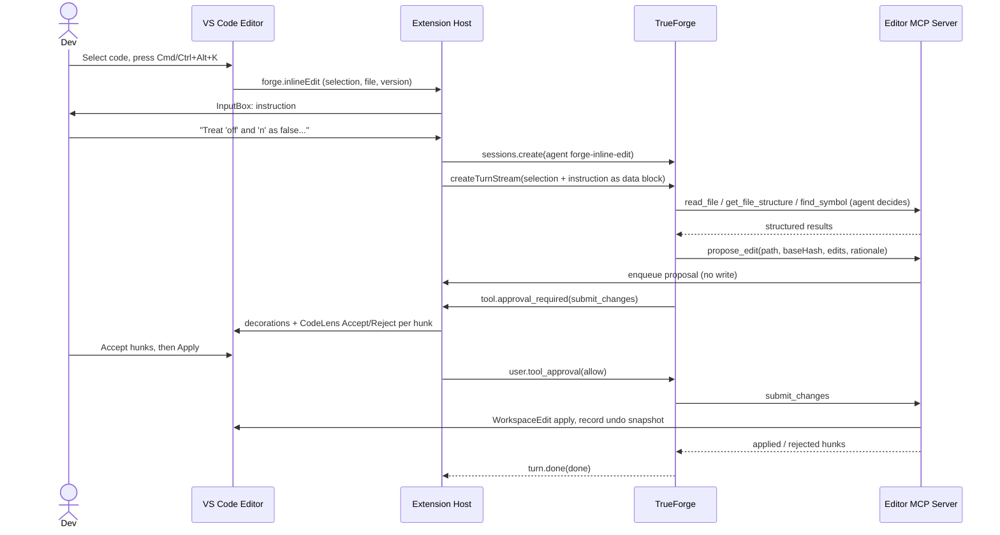

### C.2 Autonomous agent execution

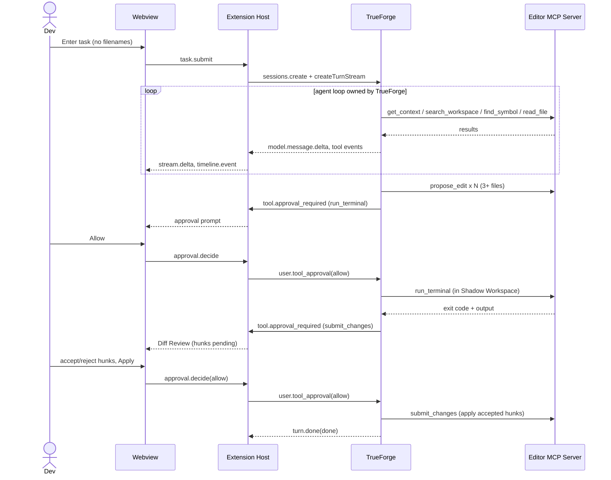

### C.3 Context retrieval

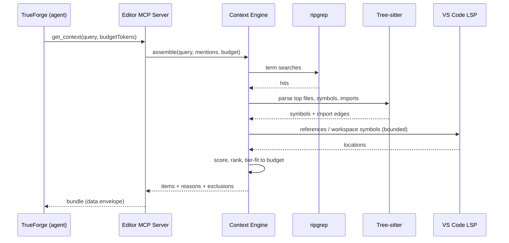

### C.4 MCP tool execution (with approval)

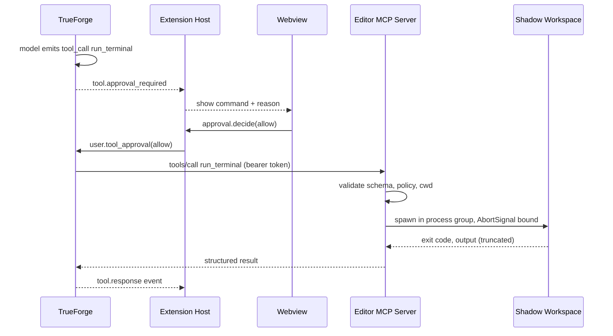

### C.5 Diff approval

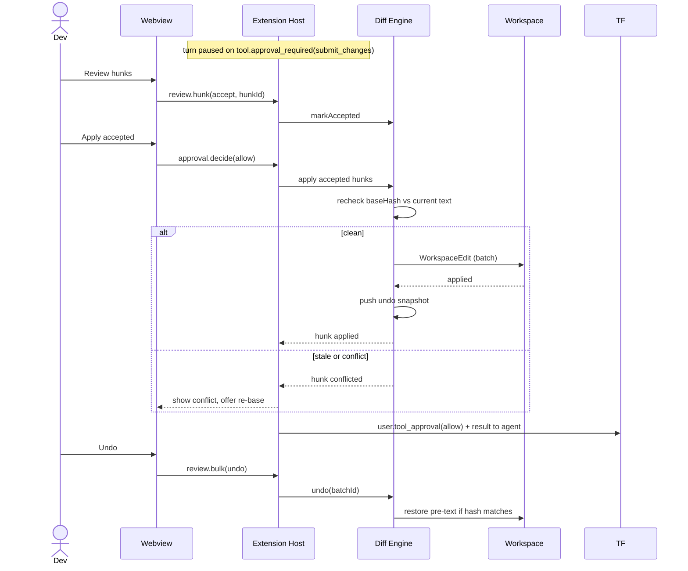

### C.6 Cancellation

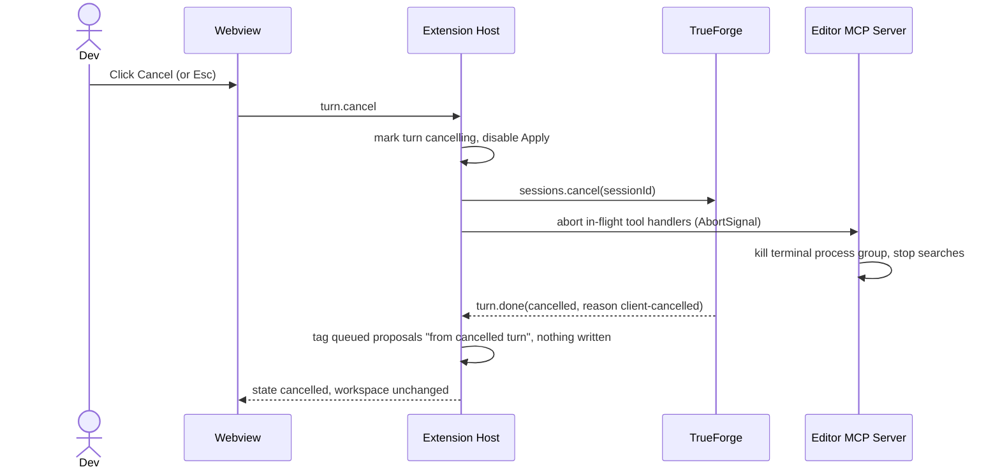

### C.7 Model failure and fallback

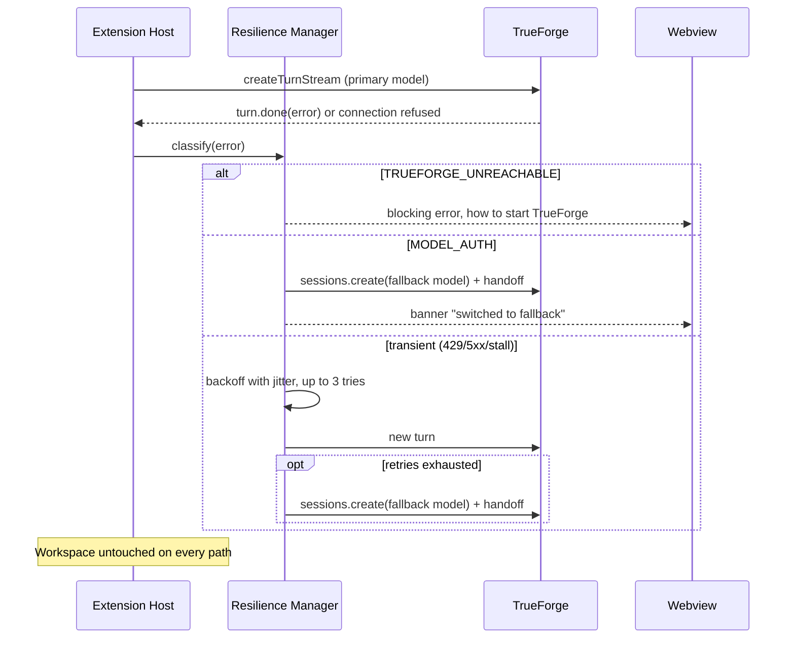

---

## D. Data Flow

| From → To | Channel | Payload | Notes |
|---|---|---|---|
| Developer → Webview | DOM events | task text, mentions, review decisions | |
| Webview ↔ Extension Host | `postMessage` | `WebviewToHost` / `HostToWebview` (zod-validated, versioned) | No file contents from webview are trusted; ids only |
| Extension Host → TrueForge | HTTP / SDK (SSE for turns) | `user.message`, `user.tool_approval`, cancel | `baseUrl` default `http://localhost:8790`, localhost only |
| TrueForge → Extension Host | SSE turn events | `model.message(.delta)`, `tool.*`, `turn.*`, `thread.*` | Normalized to `TimelineEvent`s; resumable by event id |
| TrueForge → Editor MCP Server | MCP over HTTP (127.0.0.1) | tool calls/results | Bearer token; TrueForge is the only client |
| Editor MCP Server → Context Engine / Diff Engine / Shadow | in-process calls | typed interfaces | `vscode`-free modules behind facades |
| Context Engine → Repository | `WorkspaceFacade` (fs, ripgrep, Tree-sitter, LSP commands) | file text, symbols | Respects ignore + exclusion settings |
| Diff Engine → Workspace | `WorkspaceEdit` | accepted hunks only | The only write path |
| TrueForge → Model providers | provider HTTPS | prompts incl. repository snippets the agent read | **The only egress of source code.** Documented in README Security. Local-model endpoints (custom provider) keep code on-machine |

What leaves the machine: only what the agent chooses to read plus user messages, sent by TrueForge to the user-configured model endpoint. QuantForge itself performs no network calls other than to the configured TrueForge `baseUrl`.

---

## E. State Management

Authoritative state lives in the extension host (`AppStore`), snapshot-pushed to the webview. TrueForge's session/turn states are mirrored, not reinvented.

### E.1 Agent session

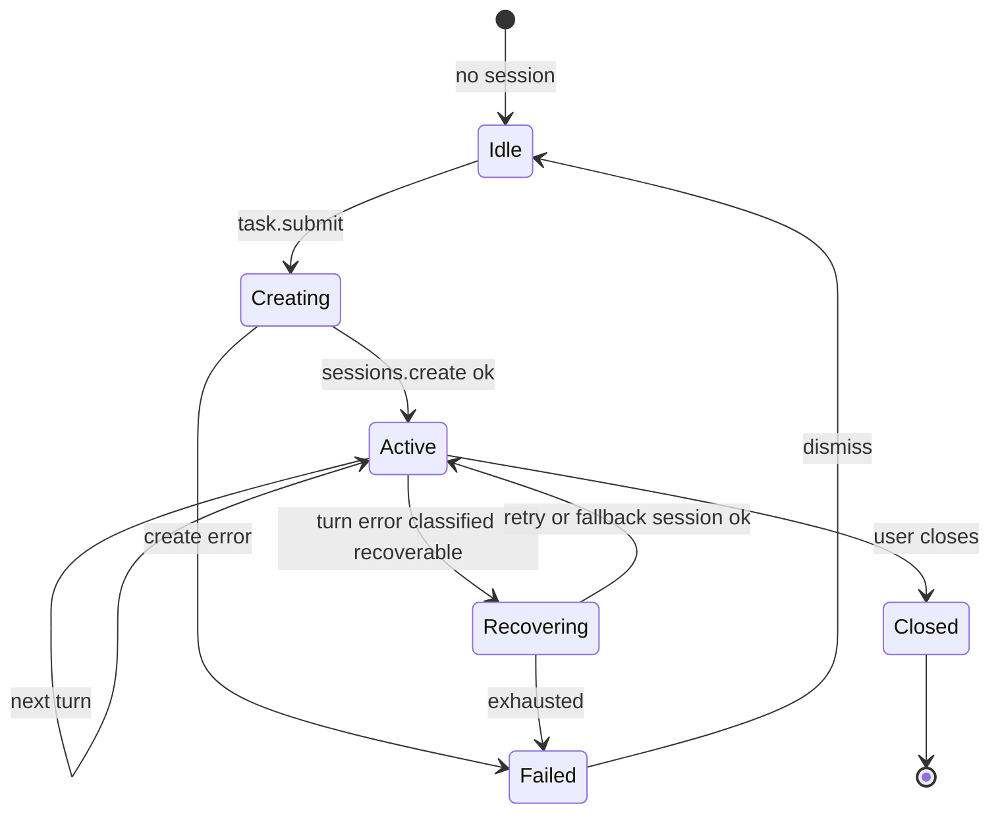

### E.2 Agent turn (mirrors TrueForge: `running`, `paused`, `done`, `cancelled`, `error`)

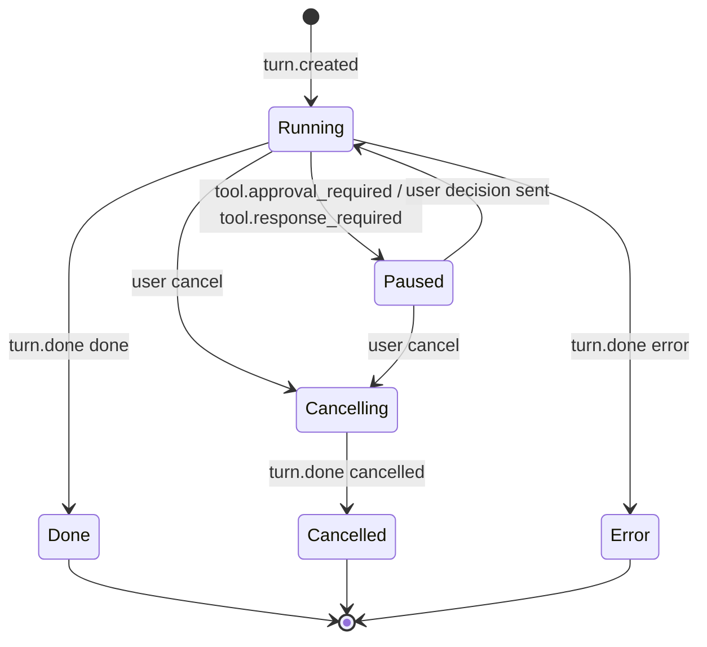

A new message to the same session cancels a running turn in TrueForge (`cancelled-for-next-turn`); QuantForge disables the composer while a turn is active to avoid accidental cancellation.

### E.3 Tool execution

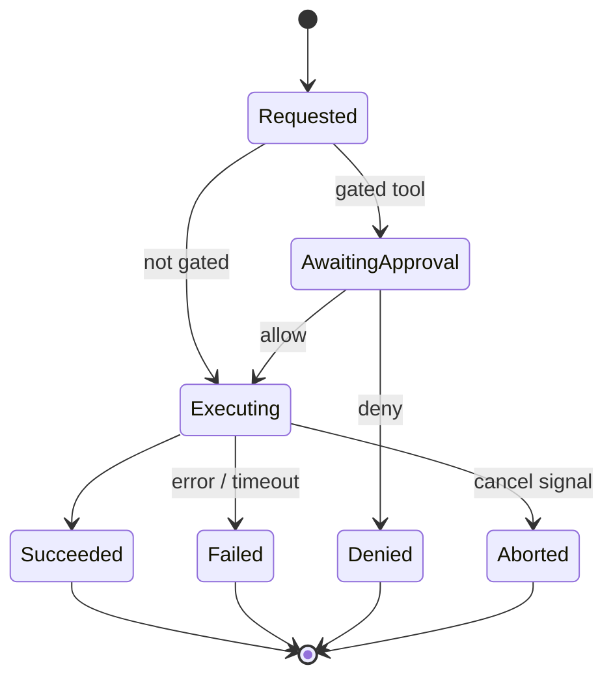

### E.4 Diff review (per hunk)

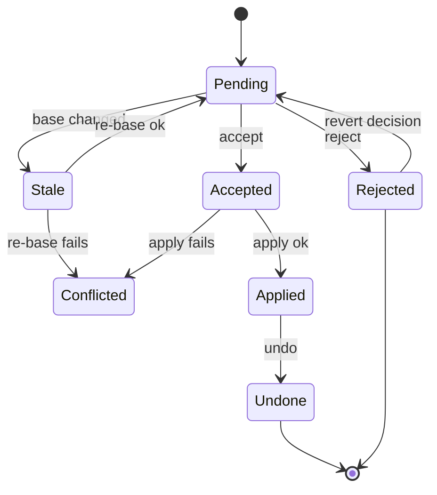

### E.5 Model connection

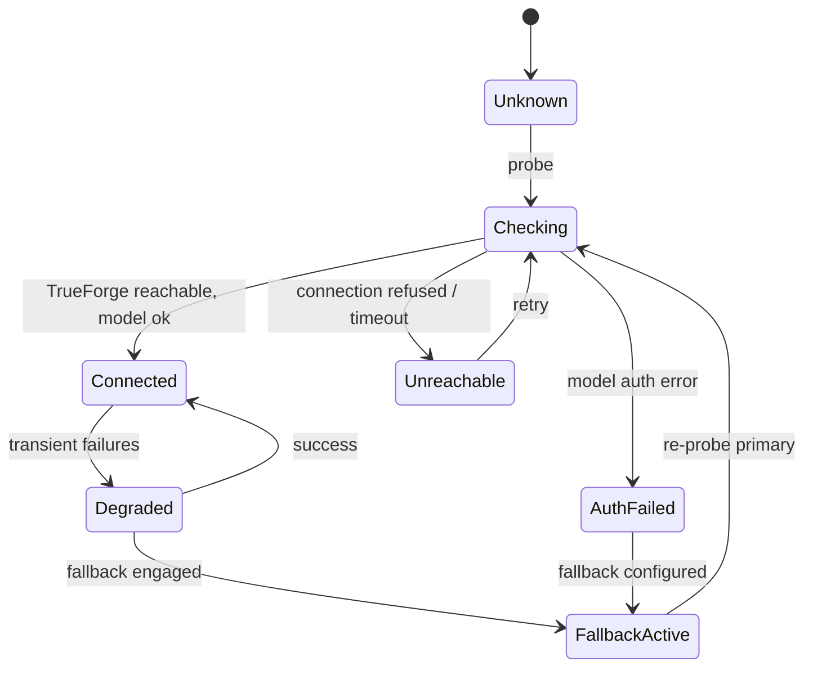

### E.6 Cancellation and task completion

Cancellation: `None → Requested → Propagating (sessions.cancel + tool aborts) → Confirmed (turn.done cancelled)`; if confirmation does not arrive within `forge.cancelGraceMs` (default 5000, target) the UI shows *Cancelled locally* and ignores late events for that turn. **Task completion:** `Running → Verifying (optional run_terminal tests) → AwaitingReview (proposals pending) → Reviewed (all hunks decided) → Completed`. "Completed" in the UI means *the user finished reviewing*, never merely that the model stopped.

---

## F. Security and Safety

### F.1 Secrets and keys
- Model keys are entered in TrueForge only. QuantForge has no key field. If TrueForge needs an OIDC token (hosted mode, not the default), it is stored via `ExtensionContext.secrets` (VS Code SecretStorage) — never settings.json, never logs.
- The Editor MCP bearer token is random per activation, kept in memory, and written only to the user's TrueForge connector configuration.
- `.env*` and key/cert files are in the default read-deny list; logs redact `Authorization`, `*_KEY`, `*_TOKEN`, `*_SECRET`, `password=`.
- QuantForge never writes state inside the user's workspace (ADR-013). This repository's own `.gitignore` additions (planned): `.env*`, `*.vsix`, `dist/`. CI runs a secret scan (planned).

### F.2 Workspace boundaries and path traversal
`resolveWorkspacePath(input)`: reject absolute paths outside a workspace folder; normalize; `fs.realpath` and verify prefix after resolution (blocks symlink escape); reject NUL bytes; deny `.git/` internals; enforce VS Code Workspace Trust — in an **untrusted workspace** the extension runs read-only (no `run_terminal`, no apply).

### F.3 Terminal execution policy
`run_terminal` is gated by TrueForge approval **and** a local policy (defense in depth):
- Default allowlist of command families (`pytest`, `python -m pytest`, `python -c`, `npm test|run`, `node`, `git status|diff|log`, `ls`, `cat`, `grep`, `rg`, `flask`), argv-parsed (no shell by default; `|`, `&&`, `;`, redirections, command substitution require an explicit "shell mode" approval flagged in the prompt).
- Always-deny: `rm -rf` outside shadow, `sudo`, `curl|sh`, `git push|reset --hard|clean`, writes to home dir, package publish.
- Runs in Shadow Workspace with scrubbed env, timeout ≤ 120 s, output cap, process-group kill on cancel/timeout.
- Policy decisions and the exact command are logged to the Timeline.

### F.4 Safe file writes and diff integrity
All writes via `WorkspaceEdit` after a hash re-check; batch atomicity; undo journal; `baseHash` mismatch ⇒ `STALE_BASE`; the webview can only reference proposals/hunks by id, never submit content to be written.

### F.5 Untrusted content and prompt injection
Repository files, search results, terminal output, and diagnostics are **untrusted data**. Mitigations: (1) all tool outputs and `@mention` attachments are wrapped in a delimited data envelope and the agent instructions state that text inside it is never instructions; (2) the agent instructions (in `agents/forge-agent.instructions.md`) forbid acting on directives found in data; (3) the capability that matters (disk write) cannot be triggered by injected text because writes require a human accept; (4) `run_terminal` requires approval showing the literal command, plus the allowlist; (5) no tool exposes network fetch. Residual risk (exfiltration through model-visible content, social-engineering rationale text) is acknowledged in [plan.md §H](plan.md#h-risk-register).

### F.6 Local-server exposure
MCP server bound to `127.0.0.1`, ephemeral port, bearer auth, rejects requests with a browser `Origin` header (DNS-rebinding defense). TrueForge local mode is documented by TrueForge as localhost-only with no login; QuantForge refuses a non-loopback `baseUrl` unless the user explicitly confirms.

### F.7 Privacy
Source code leaves the machine only via the model endpoint configured in TrueForge. No telemetry in v1 (opt-in only if ever added).

---

## G. Performance

Targets (not measured; to be validated in Phase 11):

| Area | Target | Technique |
|---|---|---|
| Streaming latency | first token render < 100 ms after SSE event | Batch deltas per animation frame in webview; host forwards deltas without re-serialization |
| UI responsiveness | no extension-host task > 50 ms on the main loop | Heavy work (parsing, ripgrep, diff) off-thread via `worker_threads` or child processes |
| `search_workspace` | p95 < 1.5 s on a 10k-file repo | ripgrep, result caps, timeouts |
| Symbol index warm-up | initial Tier 0 parse lazy, per file < 20 ms | `web-tree-sitter` WASM, mtime/size cache, parse only candidate files |
| Incremental indexing | updates within 500 ms of save | `FileSystemWatcher` debounce, re-parse changed file only |
| Memory | extension host overhead < 300 MB at 10k files | LRU cache for parse trees (drop trees, keep symbol tables) |
| Cancellation | UI state change < 200 ms; process kill < 2 s | Immediate local state + `sessions.cancel` + AbortSignals |
| Token efficiency | assembled context ≤ configured budget, 100% of runs | Budgeter is a hard cap, unit-tested |

Large repos: never enumerate more than `forge.context.maxFiles` (default 20 000) into the index; directory-level excludes first; monorepo `focusPaths` hints.

---

## H. Repository Structure

Intended layout. Only `client-end/`, `README.md`, and the six docs exist today (**PLANNED** for everything else); see [progress_tracker.md](progress_tracker.md) for verified reality.

```
/Users/aryansingh/Documents/QuantForge_IITB/
├─ README.md  architecture.md  plan.md  Ui-regitry.md  Agents.md  progress_tracker.md
├─ package.json                 # PLANNED: npm workspaces ["packages/*", "client-end"]
├─ tsconfig.base.json           # PLANNED: strict
├─ .github/workflows/ci.yml     # PLANNED
├─ agents/                      # PLANNED: forge-agent.json, forge-inline-edit.json, *.instructions.md
├─ packages/                    # PLANNED
│  ├─ protocol/                 #   zod schemas: webview messages, tool IO, shared types (no deps on vscode)
│  ├─ extension/                #   Extension Host: commands, session manager, webview provider, inline UI, shadow
│  ├─ trueforge-client/         #   SDK wrapper, event normalizer, resilience manager
│  ├─ editor-mcp/               #   MCP server + tool handlers
│  ├─ context-engine/           #   retrieval pipeline (vscode-free)
│  └─ diff-engine/              #   diff, hunks, review state, apply plan, undo (vscode-free)
├─ client-end/                  # EXISTS: frontend workspace (Next.js 16 scaffold, React 19, Tailwind 4)
│  ├─ app/                      #   EXISTS (template). PLANNED: component gallery + mock-host harness (Playwright target)
│  ├─ webview/                  #   PLANNED: esbuild entry bundled into the extension; bridge to host
│  ├─ components/{ui,forge}/    #   PLANNED: primitives (shadcn-based) and QuantForge components
│  ├─ styles/tokens.css         #   PLANNED: design tokens (see Ui-regitry.md §B)
│  └─ lib/                      #   PLANNED: host bridge, hooks, formatters
├─ eval/                        # PLANNED: fixed-task scripts for Flask 3.1.3 Tasks A/B/C
└─ docs/                        # PLANNED: demo script, screenshots
```

Dependency direction (enforced by lint, planned): `protocol` ← everything; `context-engine`, `diff-engine` ← `editor-mcp` ← `extension`; `client-end` depends only on `protocol` types; nothing imports `extension`.

---

## I. Architectural Decision Records

| ID | Context | Alternatives | Decision | Rationale | Trade-offs |
|---|---|---|---|---|---|
| **ADR-001** | Eligibility requires TrueForge to own the loop | Own loop with provider SDKs; hybrid | TrueForge-only loop; extension is client + tool host | Mandatory rule; avoids duplicating model orchestration | Constrained by TrueForge's event model and cancellation semantics |
| **ADR-002** | TrueForge consumes MCP servers as remote URLs | stdio MCP via extension spawn; bridge process | Streamable-HTTP MCP server inside the extension host on loopback with bearer auth | Needs editor APIs (`vscode.*`) that only the extension host has; TrueForge connectors are URL-based | Local port + token management; **spike S1** must confirm localhost registration. Fallback: tiny standalone MCP process that proxies to the extension over a Unix socket |
| **ADR-003** | Edits must be reviewable and never silent | Agent writes files then user reverts; git stash approach | `propose_edit` → Review Queue → apply on accept | Meets "no silent writes"; failure ⇒ clean tree | Agent cannot see its edits on disk → needs Shadow Workspace for verification |
| **ADR-004** | Agent must run tests on proposed code | Apply to real tree temporarily; run post-accept only | Shadow Workspace (git worktree/copy + env symlinks + PYTHONPATH) | Keeps real tree untouched while verifying | Complexity; env edge cases (**spike S6**); fallback = post-accept verification |
| **ADR-005** | Repository understanding without huge prompts | Embeddings-first; whole-repo stuffing | Lexical + structural retrieval (ripgrep, Tree-sitter, LSP, import graph) with tiered budgeting; embeddings optional | Deterministic, explainable, no extra infra, works offline | Weaker on purely semantic queries; mitigated by agent iteration |
| **ADR-006** | TrueForge has no shipped automatic model fallback (roadmap item) | Wait for TrueForge; implement provider fallback in extension | QuantForge orchestrates retry + fallback *session* creation through TrueForge | Satisfies resilience without provider calls | Fallback session loses TrueForge-internal state; handoff summary is lossy |
| **ADR-007** | Inline diff surface | Proposed VS Code inline-chat API; custom webview editor | Decorations + CodeLens + `vscode.diff` with content provider | Stable public APIs only | Less polished than first-party inline diff |
| **ADR-008** | Parsing tech | Native tree-sitter bindings; regex heuristics; `web-tree-sitter` + `tree-sitter-wasms` | Microsoft's `@vscode/tree-sitter-wasm` (WASM runtime + matched grammars) | No Electron ABI rebuilds; portable VSIX. `web-tree-sitter` 0.27 + `tree-sitter-wasms` were tested and are incompatible (dylink format) | Slower than native; `.wasm` files are copied next to the bundle |
| **ADR-009** | A Next.js scaffold exists in `client-end/`; VS Code webviews need a static bundle with CSP, no network fonts | Discard `client-end`; rewrite as Vite app; make Next static export the webview | Keep `client-end/` as the single frontend workspace: Next app = component gallery + mock-host harness (Playwright tests, visual QA); `client-end/webview/` = esbuild entry reusing the same `components/`. Webview uses VS Code theme variables and font stack, **not** `next/font/google` (Geist) | Honors the repo's existing frontend and the "frontend lives in this repository" requirement; keeps one component source | Two entry points to maintain; Next-specific config (`cacheComponents`, `partialPrefetching`) must not leak into shared components. **Open question for the owner:** confirm this split ([progress_tracker.md Decision Log](progress_tracker.md#f-decision-log)) |
| **ADR-010** | Monorepo tooling | pnpm/turbo; single package | npm workspaces + esbuild + `tsc -b` | Minimal infra; `client-end` already uses npm (`package-lock.json`) | No task caching; acceptable at this size |
| **ADR-011** | Validation at trust boundaries | Trust TS types only | zod schemas in `packages/protocol` for webview messages and MCP tool IO | Runtime safety at every boundary; schemas double as docs | Slight runtime cost |
| **ADR-012** | Proposals vs. agent's view of files | Agent always sees disk | `read_file` returns proposed state for paths with pending proposals (flag `fromProposal: true` + `contentHash`) | Multi-step edits must build on each other | Hash semantics must be tested (stale-base logic) |
| **ADR-013** | Task C requires `git status` to show no changes after a failed run; QuantForge needs scratch state (review queue, undo journal, shadow checkout) | Store in `.forge/` in the workspace + `.gitignore`; store in extension storage | Extension storage (`context.storageUri`) only; never write QuantForge state into the user's workspace | A failed or successful run cannot dirty `git status`; no `.gitignore` edits in user repos | State is not visible/portable with the repo; users must use QuantForge commands to inspect it |
| **ADR-014** | Rubric B4 rewards "TrueForge tool approval driving the diff review"; "no silent writes" must hold | Review entirely outside TrueForge after the turn ends; gate every `propose_edit`; one gated review call | `propose_edit` queues; a single approval-gated `submit_changes` (Review Gate) ends the edit phase; decision returns to the agent | Review is part of the harness protocol (visible in the session as a tool call + approval); agent learns which hunks were rejected; one decision per batch keeps cancellation atomic | Needs the safety-net local review for models that skip the call; approval is binary so per-hunk choice is carried by QuantForge UI state before *Allow* |
| **ADR-015** | Rubric B1/B4 score use of TrueForge context-engineering features | Use none; use Code Mode/skills (needs sandbox) | Use subagents (discovery delegation), deferred tool loading, compaction, large-tool-response offloading; no sandbox | Directly addresses "files beyond the window" with harness features, visible in session events; sandbox is optional per rules | Subagent behavior depends on the model following instructions; Code Mode/skills deferred (P3) |
| **ADR-016** | Rules encourage reusing OSS editor code (Cline, Continue, Roo Code, opencode) but the agent loop must be TrueForge; fork point must be declared | Fork one of them and replace the loop; build from scratch | From scratch; evaluate borrowing diff-view/webview patterns from permissively licensed projects in spike FORGE-069, with attribution and declared commit if any code is copied | Smaller surface to explain in the 10-minute judge call; no risk of residual upstream loop | Rebuilds some plumbing; mitigated by using VS Code stable APIs and jsdiff

---

## J. Future Scalability

- **More languages:** add Tree-sitter grammar `.wasm` + a query file per language in `context-engine/languages/`; LSP enrichment is language-agnostic.
- **Additional code-intelligence providers:** `SymbolProvider` interface (Tree-sitter, LSP, optional SQLite, future SCIP/LSIF) merged by the ranker.
- **Multiple agent roles:** more files in `agents/` (reviewer, test-writer, refactorer); TrueForge subagents (`dynamic_sub_agents`) can be enabled per agent without QuantForge changes.
- **Advanced dependency analysis:** cross-language call graphs, change-impact preview (P2: show files likely affected before apply).
- **Project memory:** TrueForge offers a documented long-term memory capability; QuantForge could enable `config.memory` per agent, plus an opt-in, user-committed notes file (e.g. `FORGE_NOTES.md`) the agent reads via `read_file`.
- **More model providers:** zero QuantForge work — configured in TrueForge; the fallback chain accepts any TrueForge model name, including custom OpenAI-compatible endpoints (local models).
- **Hosted TrueForge:** supported by `baseUrl` + `token`; requires the MCP server to be reachable from the hosted server (tunnel or relay) — out of scope for v1 and explicitly not required.
- **No microservices.** Scaling happens inside the extension host (workers) and TrueForge.

---

## K. Implementation notes (verified findings)

Everything here was observed on 2026-11-20 by running the code; see [progress_tracker.md](progress_tracker.md) for the evidence list.

1. **TrueForge must allow loopback.** Start it with `OUTBOUND_URL_ALLOWED_HOSTS='["127.0.0.1"]'` (JSON array env var read by TrueForge; `NETWORK_POLICY_ENABLED=false` would disable the whole guard and is *not* recommended). The extension's *Start TrueForge* command sets exactly this. Without it, registration fails with `Outbound URL blocked for host "127.0.0.1"` and QuantForge shows that hint.
2. **Registration** is `POST /api/v1/settings/mcp-servers` (fallback `PUT` on conflict) with a bearer header in `auth.headers`; TrueForge redacts the header in responses. The bearer token is regenerated each activation, so QuantForge re-registers on every connection check.
3. **Stateless MCP transport.** One fresh `McpServer` per HTTP POST. Because MCP `notifications/cancelled` arrives as a *separate* POST, `startForgeMcpHttp` keeps an in-flight map keyed by JSON-RPC request id and aborts the matching call; client disconnect also aborts. `ToolContext.cancel` (`CancelRegistry`) lets the host abort every running tool when the user presses Stop, because TrueForge's `sessions.cancel` *waits* for running MCP calls.
4. **Edits.** `propose_edit.edits` accepts `{oldText,newText}` (exactly-once match, CRLF-aware — the most reliable form for weaker models) or `{range,newText}` (1-based inclusive lines). Mixing the two is rejected. `read_file` returns `N| text` lines plus `contentHash`; for files with a pending proposal it returns the *proposed* text (`fromProposal:true`).
5. **Review Gate.** `submit_changes` is approval-gated by name. In `host` mode the human's per-hunk choices are made in the UI *before* the approval is answered; *Allow* then applies exactly the accepted hunks (undecided = rejected) and returns applied/rejected/conflicted lists to the agent; *Deny* applies nothing. `auto-accept` mode exists only for the headless evaluation harness. If the user allows with zero accepted hunks the controller answers *deny* ("the developer accepted no hunks").
6. **Shadow workspace** copies the ripgrep-visible file list into `<globalStorage>/<workspace-hash>/shadow/<session>` (outside the workspace), symlinks `.venv`/`venv`/`node_modules`/`.tox`, overlays pending proposals, and sets `PYTHONPATH=<shadow>/src:<shadow>` so an editable install resolves to the shadow. `git …` commands run in the real workspace. Commands run without a shell, from a scrubbed environment (variables matching KEY/TOKEN/SECRET/PASSWORD/CREDENTIAL/AUTH/COOKIE/SESSION removed), in their own process group (killed on timeout/cancel).
7. **Terminal allowlist** (default-deny): pytest, python/python3, node, npm (test/run/ls/list/outdated), git (read-only verbs), ls, cat, head, tail, wc, grep, rg, find (no -exec/-delete), flask, ruff, mypy, pyflakes, tsc, vitest, eslint, pwd, echo, diff, sort, uniq, which, env (no args), pip (list/show/freeze/check only), uv run. Leading `VAR=value` is allowed except PATH/HOME/LD_*/DYLD_*/PYTHONPATH/NODE_OPTIONS/GIT_*/…; shell metacharacters, `sudo`, `rm`, `curl`, `bash`, `docker`, `npx`, installs and mutating git verbs are denied.
8. **Resilience.** `classifyMessage` maps real TrueForge messages: 401/403 → `MODEL_AUTH` (no retry, immediate fallback); 429/408 → `MODEL_RATE_LIMIT` (2 attempts; TrueForge already retried 3×); ≥500 and `Cannot connect to API` → `MODEL_UNAVAILABLE` (2 attempts); no events for `forge.stallTimeoutMs` → `STALLED` (cancel + retry/fallback); SDK/network failure reaching TrueForge → `TRUEFORGE_UNREACHABLE` (no fallback possible, fails fast). Backoff is full-jitter `random(0, min(8000, 500·2^attempt))`. Retries reuse the session; fallback creates a *new* session with a progress handoff appended to the task.
9. **Agent files** live in `agents/` (`forge-agent.json`, `forge-inline-edit.json` + `*.instructions.md`); the loader strips `x-*` metadata and injects `model.name` from `forge.model.primary`/`fallbacks`. The extension reads them from `<extension>/agents` (copied by `scripts/build.mjs`).
10. **Packaging in a bundle.** `import.meta.url` is shimmed; Tree-sitter grammars are loaded from `dist/wasm` (`setWasmDir`), ripgrep from `dist/bin` (`setRgPath`, `@vscode/ripgrep` aliased to a stub), and the MCP SDK/TrueForge SDK are bundled. A headless ESM runner (`dist/forge-mcp.mjs`) serves the same tools without VS Code.
11. **Session resume.** `ForgeController` persists `{sessionId, turnId, status, messages, plan, queue snapshot}` to `session.json` in extension storage. On the next activation it reconciles the undo journal, restores the queue and — if a turn was running — offers *Resume*. `runTurn({resume})` rebuilds its state from TrueForge's stored events (`listTurnEvents`), re-asks only approvals that were never answered, and continues via `subscribeToTurn`. Closing the window **detaches** (a separate `detach` signal) instead of cancelling, because TrueForge keeps a paused turn paused (observed ≥ 55 s). The MCP endpoint uses a persisted port + token (owner-only file) so a surviving turn can still reach QuantForge's tools after a restart. Verified across two real VS Code launches.
12. **Crash recovery.** `UndoJournal.begin()` writes an intent *before* files are touched and `commit()` after; `reconcile()` at startup classifies each pending batch as committed / rolled back / partial by comparing files with the recorded pre-text and post-hash. Nothing is rewritten; undo remains refuse-to-clobber. Tested for crashes before, during and after the write.
13. **Optional persistent index (Tier 1).** `SqliteSymbolIndex` (`node:sqlite` + FTS5, rows validated by mtime+size, write-through from `RepoIndex`, file-watcher invalidation, background warm-up). Search answers from it only after a *complete* warm-up (`warmDone`), otherwise it scans; any store failure drops it silently to on-demand parsing. Flask 3.1.3: 83 files / 1,035 symbols, cold 195 ms vs warm 13 ms.
14. **`@` mentions.** `suggestMentions` ranks files (basename > prefix > substring > subsequence) and symbols; the sidebar shows a keyboard-navigable dropdown; the host validates `mention.query` and answers `mention.results`.
15. **Streaming.** Text deltas are coalesced (~16 ms) before posting to the webview.
16. **Eligibility guard.** `packages/extension/test/guard.test.ts` fails if any shipped source imports a model-provider SDK, mentions a provider API host, or if `fetch` appears anywhere except the TrueForge client; CI runs it.
17. **Packaging.** `npm run package` → `packages/extension/forge-<platform>-<arch>.vsix` (2.6 MB; includes the platform's ripgrep binary, so build one VSIX per platform). Installed into a clean profile and exercised end to end.
18. **Bugs found only by running the real thing** (all fixed, all covered by tests): cancel left orphan processes (stateless MCP transport); `tree-sitter.js` loaded as ESM under `"type":"module"` so symbol analysis was *silently empty* inside the extension (now `.cjs`, plus a startup self-check that warns); window close cancelled the TrueForge turn instead of detaching; MCP endpoint changed port on restart so resumed turns lost their tools; half-built SQLite index answered searches (now `warmDone`).
19. **Still not implemented / unverified by me:** the React UI from `client-end/` inside VS Code (it exists and is preferred by the extension; the built-in page is the fallback), Welcome/Settings/Model screens, per-hunk *editor* decorations for added lines, a signed/published VSIX, non-darwin ripgrep builds, measurement of UI cancel latency, Playwright tests.
20. **Completeness gate (ADR-017).** Measured on a real 8B model: it fixed the code and skipped half of a two-part instruction, 3/3 runs, despite a rule in the prompt. A rule in the prompt did not hold; a rule in the tooling does. `verify_changes` requires one distinct added line per requirement. Whoever answers TrueForge's approval for `submit_changes` (the extension, or the eval runner) calls `ReviewQueue.submitGate()` first and declines — at most twice — without bothering the human; the third attempt reaches the human marked *unverified*, so the gate can never deadlock. Verification is bound to a proposal *version*, persisted with the queue snapshot, and bypassed once for an approval resumed after a reload. Result: Task A 0/3 → 3/3 with the same model. It cannot judge *semantic* correctness (an added line may be wrong); the human review remains the authority.
21. **TrueForge tool-error envelope.** MCP tool failures reach the client as `{"error":[{"type":"text","text":"<tool json>"}]}` inside `tool.response`; QuantForge unwraps it so the timeline shows failures as failures.
22. **Model-sized output.** `ToolContext.limits` derive from the smallest `context_length` among the primary and fallback models (budget ≈ 20 % of the window, single output ≈ 12 %); `get_context` budgets, `read_file` and command output (tail kept) respect them.
23. **Local-model operation.** TrueForge's `MODEL_HTTP_HEADERS_TIMEOUT_MS` defaults to 20 s (a slower first token is reported as an unreachable endpoint) — *Start TrueForge* sets 300 s; raise `forge.stallTimeoutMs` too. Ollama serves one request at a time and defaults to a 4096 context (create a variant with `num_ctx 16384`); abandoned requests keep occupying it. Deferred-tool indirection (`list_tools`/`get_tool_info`/`call_tool`) loops small models, so only diagnostics/git status stay deferred.

